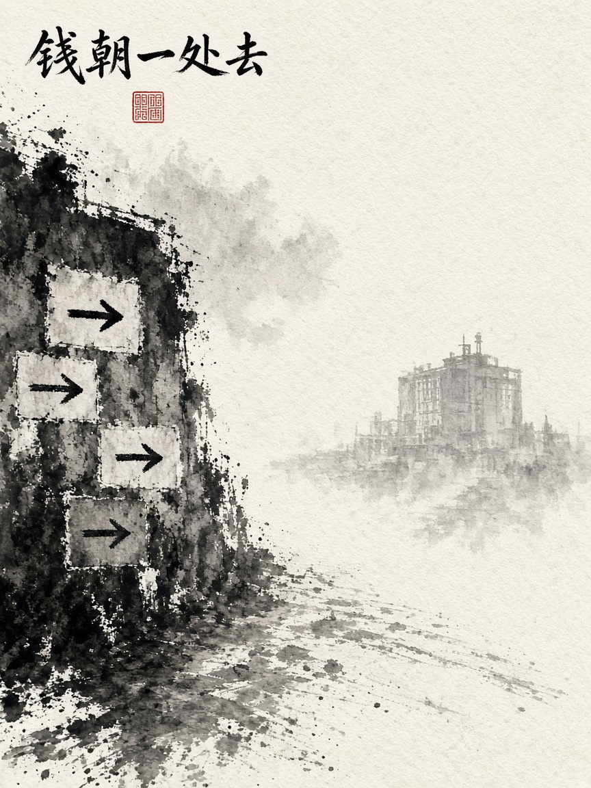
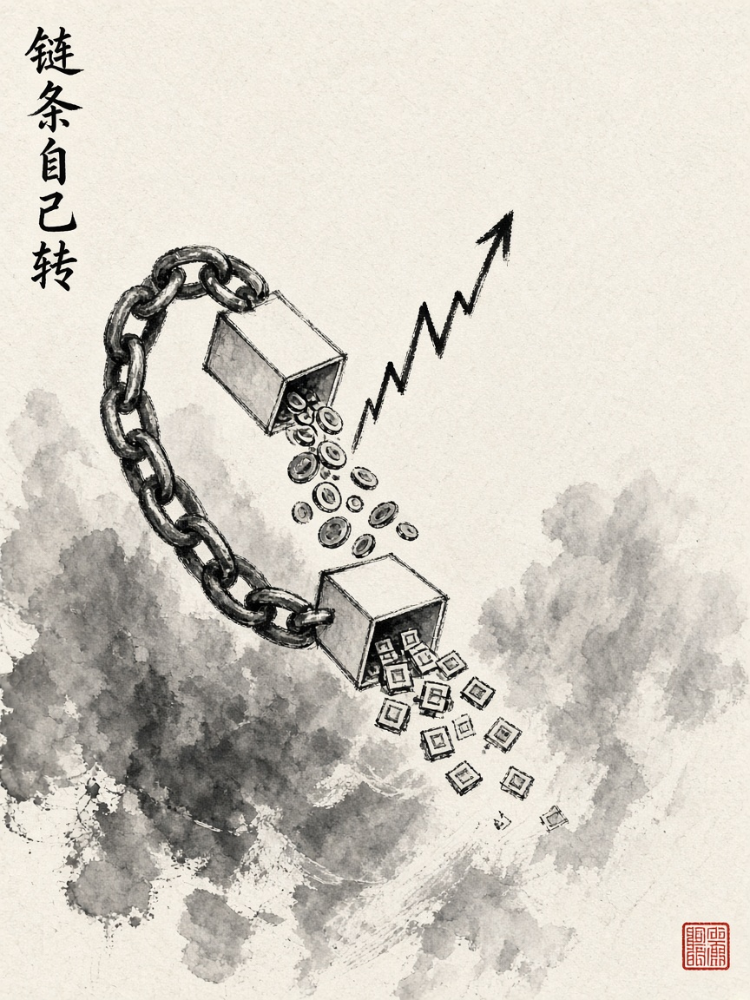
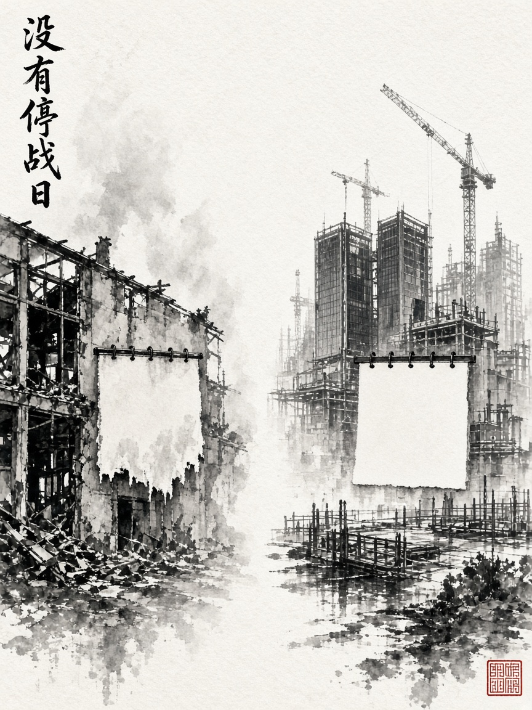
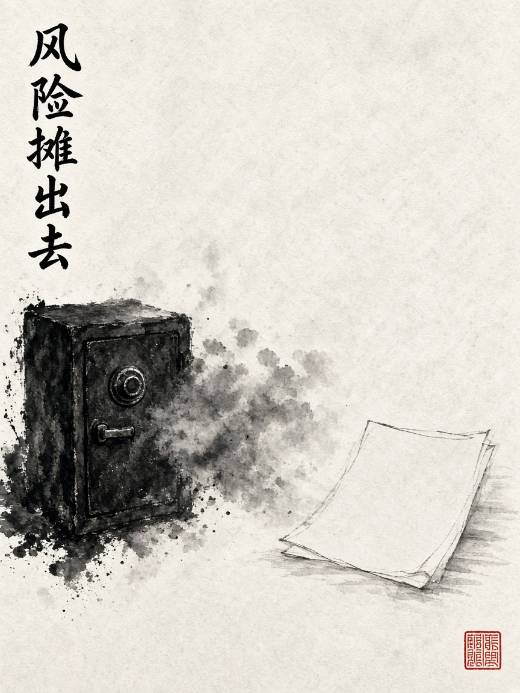

这两天又刷到华尔街见闻那篇《全民总动员》，标题挺冲，副题更冷，风险社会化、收益私有化。坦率的讲，我觉得它不是在预测哪天泡沫破，是在换一副尺子，把九个月里那些破纪录融资排成一队，看钱最终都去了哪。IPO、增发、私募、投资级债、垃圾债、回购、公用事业并购，几乎被同一个主题征调完了。我没逐笔核对原始招股书和债券说明书，数字都是见闻那篇转述。读完想带走的是，这更像资源动员，不太像普通牛市，而动员这套机器最怕的是没有停战日。

怎么说呢，单独看每笔都是新闻，排在一起才吓人，所有钱几乎朝一个方向走。

见闻写的是，一个经济体能调动的融资工具，九个月里被同一主题征完了。这不是鸡犬升天那种牛市，是资源动员。

你想想看，OpenAI 拿到大约 1220 亿去买 GPU，英伟达大约 1500 亿回购增额托住链条，软银为了凑钱还发了约 111 亿垃圾债。链条自己转起来了。

上一次这种规模的资源集中，文章说是在战争年代。比较骚的事是，战时至少还有个停战日可以盼，这场经济战的日历格是空的。

副题那句我还挺记得，风险社会化、收益私有化。电要给最大的数据中心市场供电，并购都打到公用事业身上了。

我没在做空也没在做多。国内聊 AI 热的时候，也常卡在繁荣还是泡沫那两格。我觉得更值得先看的是，钱被征到同一条线之后，这套机器还有没有刹车。
