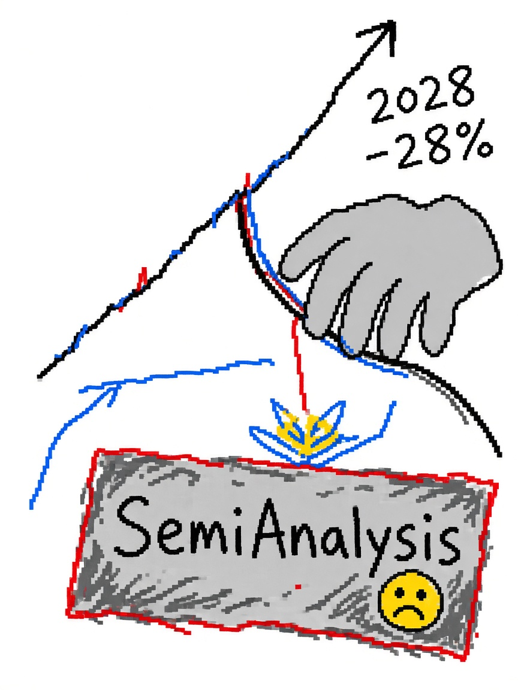
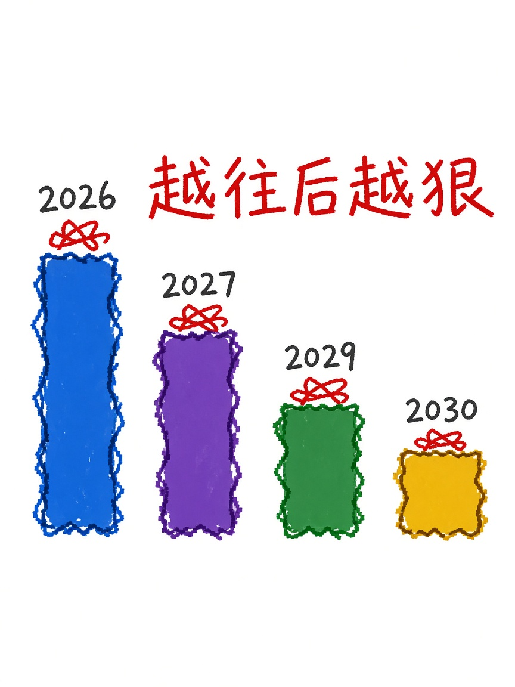
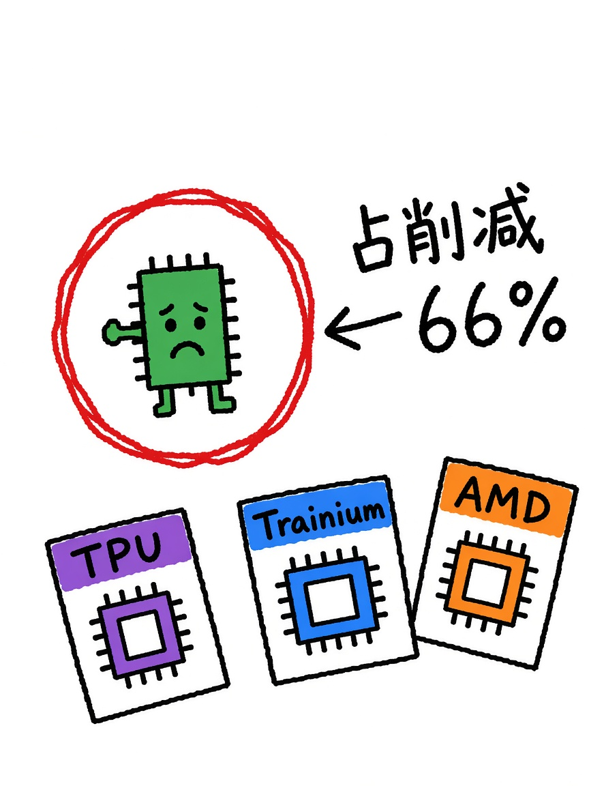

这两天刷到华尔街见闻一篇转稿，半导体研究机构 SemiAnalysis 把未来几年 AI 加速器资本开支模型往下拽了一大截。2028 年那一格，预测直接砍掉将近三成，从 1.054 万亿调到 7580 亿。我自己还没打开他们付费模型核对底表。坦率的讲，我觉得热闹不在凉不凉，而在还能不能假装直线往上飞。

SemiAnalysis 11 月 13 日更新模型。2028 年全球 AI 加速器资本开支预测，从 1.054 万亿降到 7580 亿，大概砍了 28%。

怎么说呢，2026 年那一档几乎没动，还在 3920 亿附近。从 2027 开始往下修，2029、2030 更狠，分别砍了四成左右。

他们自己的解释也不玄乎。前沿实验室第三季度新增 ARR 增速放缓，债主对没大厂采购承诺的机房项目更怂。钱跟不上，供给预期就得往回拽。

你想想看，不是突然不缺电了。2030 年加速器功耗需求预测砍了大约 34%，2028 年 HBM 需求砍了大约 30%。建得起来的变少，高价假设也开始松。

硅片出货面积 2026 到 2030 累计下调 17%，英伟达大概占了削减的 66%。我是真的觉得，这不是全行业平均挨刀，是点名分人。

比较骚的是，算力还在买。博通相对扛得住，亚马逊 Trainium 近端预测几乎没砍。规则拧在这儿，需求没消失，只是不再只认一张牌。

回到咱们平时刷到的算力叙事这块。别急着把下调读成完蛋。增长还在，2026 的 3920 亿，新模型里仍可能长到 2030 的 9230 亿。只是口号该换成，谁出得起钱，谁买得长久，谁能撑到账上。
