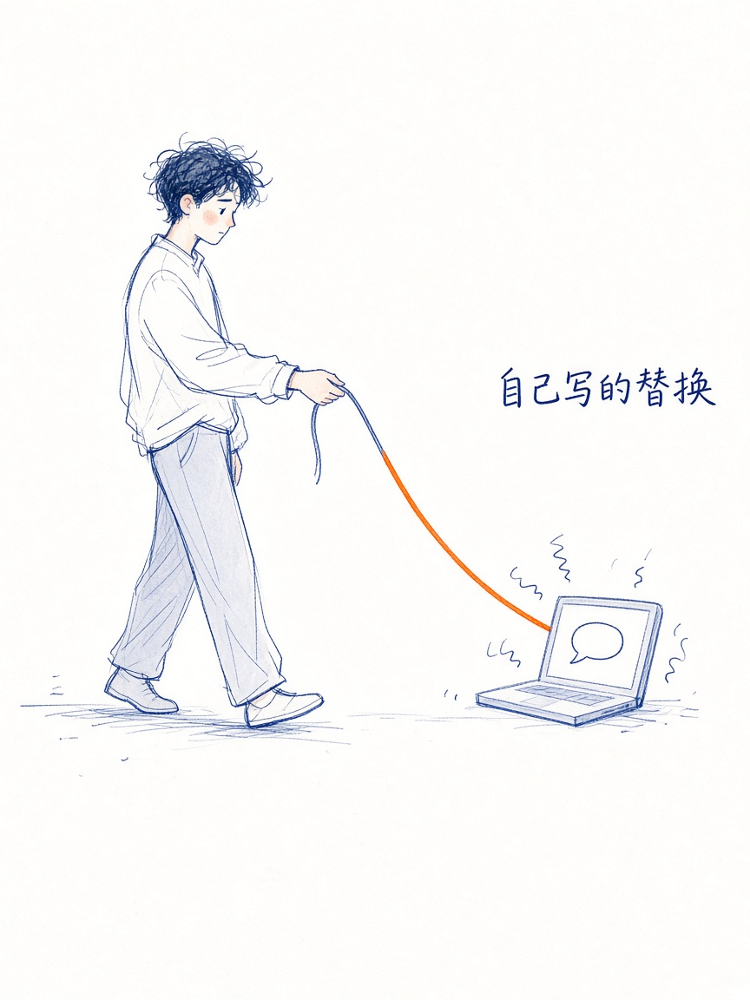
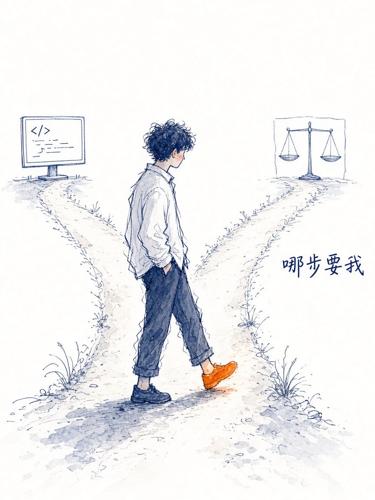

这两天刷到 HN 一条 Ask，产品赚钱了，AI 写代码，我感觉自己没用。发帖的人 2019 边打工边做 SaaS，现在客户每周付钱，轻松盖过以前工资。我还没亲自养过这样一个 solo 产品。坦率的讲，我觉得最扎人的不是账单空了，是调试那种「坏了、我修、因为我才好」的快感没了。

产品在跑，钱也进账。怎么说呢，外面看像成功，里面像人被挤出主线。

他怀念的是旧画面，东西坏了，他埋进去，修好了，功劳落在自己身上。

现在代码大半稳了，剩下的多半交给 AI。他自己还写了 harness，让模型替自己干活。

有人说，手写一部分，保住脑里的地图，出事才不至于迷路。

也有人怕技能生锈，脑子空转。你想想看，收入稳了，证明路径却断了。

国内用 Cursor、Claude Code 把活推走的人，也能对上这口空落。你要是也觉得「这不算我做的」，这块可以先问，还有哪一步需要我的判断。
