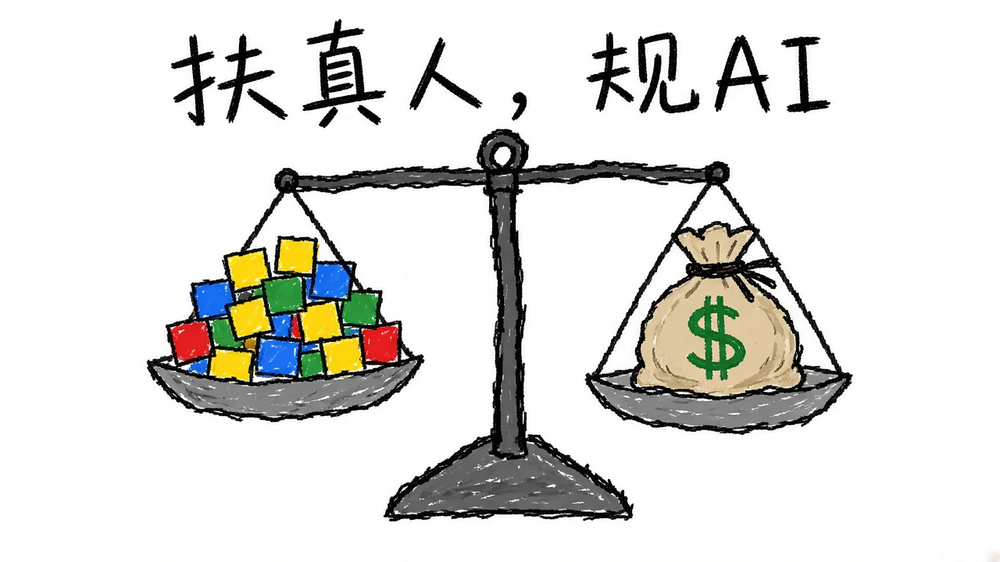
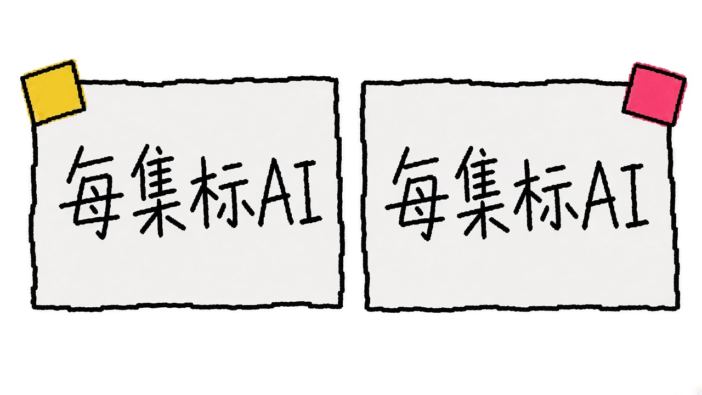

这两天刷到广电又在微短剧论坛上重申态度，扶持真人剧，规范AI剧。坦率的讲，我一开始有点懵，公开数据里前八个月上线大约四十三万部微短剧，AI剧占比超过九成。量大成这样，怎么还在强调给真人加码？我还没自己拍过短剧，不过把海外那套标注和授权规矩，跟国内《微短剧发展管理办法》对过一遍之后，我觉得这件事更像是在修赛道，不是一刀切掉AI。

好莱坞这边先吵的是演员的脸和声音能不能随便生成。SAG-AFTRA 那套，核心就一句话，数字分身得先问本人。

纽约等地广告里用合成表演者，得明示这不是真人。怎么说呢，先让观众知道自己在看什么。

回到国内这块，前八个月大约四十三万部上线，差不多是去年全年的十三倍，AI剧超九成。你敢信？？？量已经不是同一量级了。

广电的说法其实挺直白，真人是精品主力，资金、算法、评优往真人偏。规范AI不是不让做，是要稳量提质。

办法里写了，用人工智能生成制作的微短剧，得在每集明显位置加提示标识。刷片的时候，那两个字才是给你看的。

分类门槛也不一样。一般题材里，AI剧进一类的投资门槛更低，大约八十万，真人大约三百万。钱少也能进严管通道，这规矩挺拧的，也挺有意思。

平台这边被要求压实责任，凡播必审、全量人审。同期下架违规大约六点八万部，处置账号大约一千二百个，九成以上是AI剧。

所以我自己的感受是，以后刷到一部微短剧，先看有没有AI提示，再看它是不是往真人精品那条道上靠。技术能生成画面，生活感还得人来。
