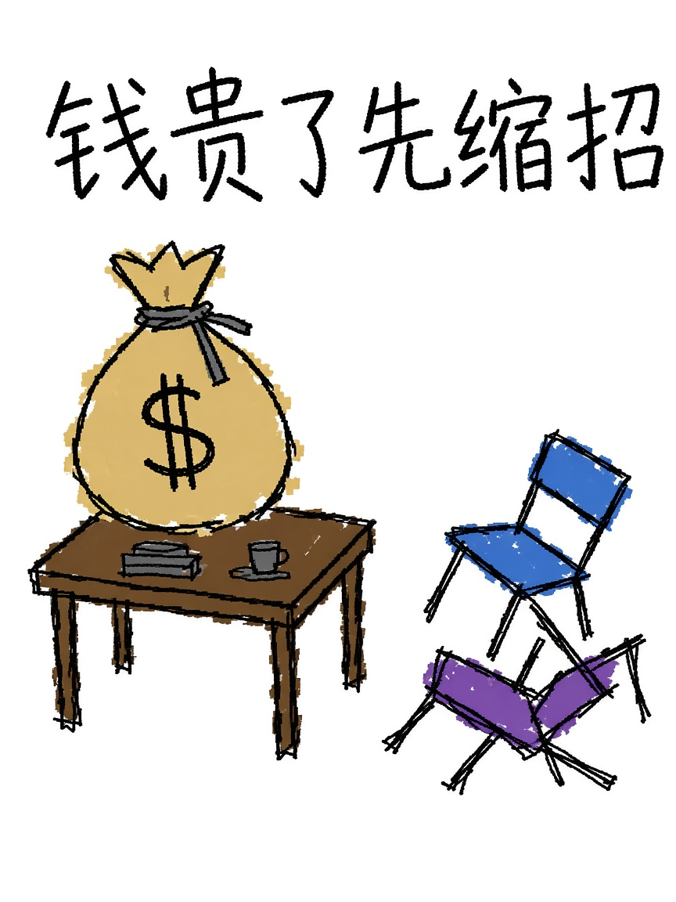
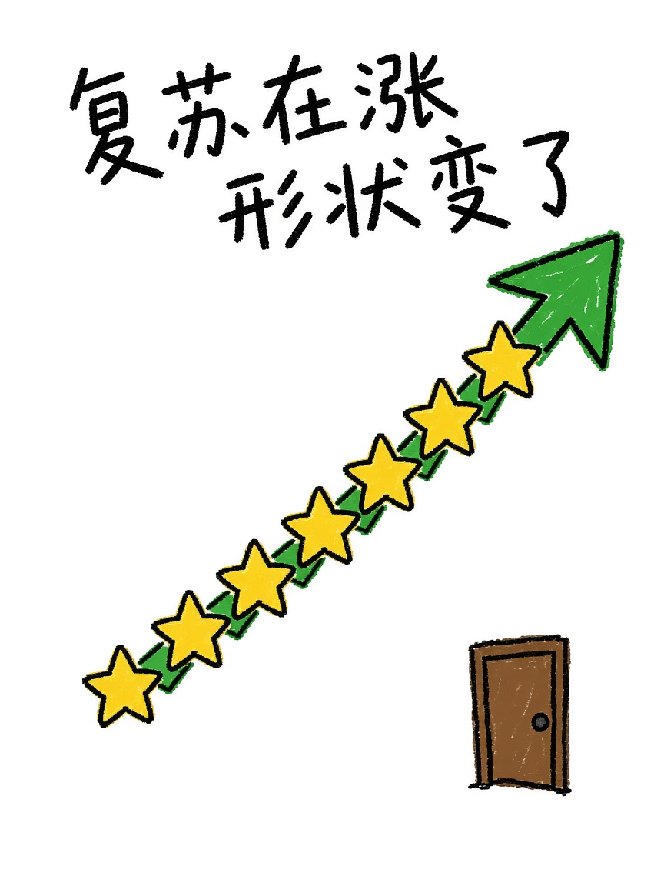

这两天刷到 Ricardo Pallás 那篇长文，他从《Good Night, and Good Luck》里麦卡锡靠恐惧吃饭写起，一路对到软件就业数据。坦率的讲，我觉得值得拿走的不是 AI 会不会灭掉程序员这句话，是两套尺子。招聘大崩盘更对齐 2022 年加息和疫情后去泡沫，ChatGPT 上线前美国软件岗位已经跌掉一大截。AI 真正留下来的痕迹，更像复苏形状变了，资深还在招，刚入行的更难进门。

怎么说呢，信息流里天天有人说工程师半年内会被换掉。有人靠互动吃饭，有人卖模型时也需要 AI 看起来又强又危险。麦卡锡那会儿，名单真不真不重要，怕就够了。

Indeed 美国软件招聘指数峰值在 2022 年 2 月。ChatGPT 上线前已经跌了大约 39%，总跌幅里一半以上发生在它出现之前。你想想看，时间线先撞上加息，不是先撞上聊天窗口。

软件是今天花钱、以后才可能回本的活。钱接近零的时候公司猛招人赌五年后，利率到 5% 附近，这套算法自己就会停。我没管过美国公司账本，只是把利率和招聘曲线并排放。

2025 年 5 月之后，美国软件岗位在涨，全行业岗位几乎横着。Indeed 自己也写过，Claude Code 上线后软件招聘涨了差不多 15%。可增量里，七成多落在资深岗，带 AI 字样的职位也吃掉一大块。

斯坦福用 ADP 工资单看到，22 到 25 岁、岗位最挨着 AI 的人，相对就业大约低 19%。同岗位年纪大一些的没有这道缺口。主要是少招新人，不是先把老人裁掉。

Amodei 说过模型很快能干掉大部分软件工程活。可 Pallás 翻归档看到，Anthropic 带 Software Engineer 的空缺从 2026 年 2 月的 44 个涨到 10 月的 97 个。我自己的感受是，工作在变，岗位没有按话术蒸发。
