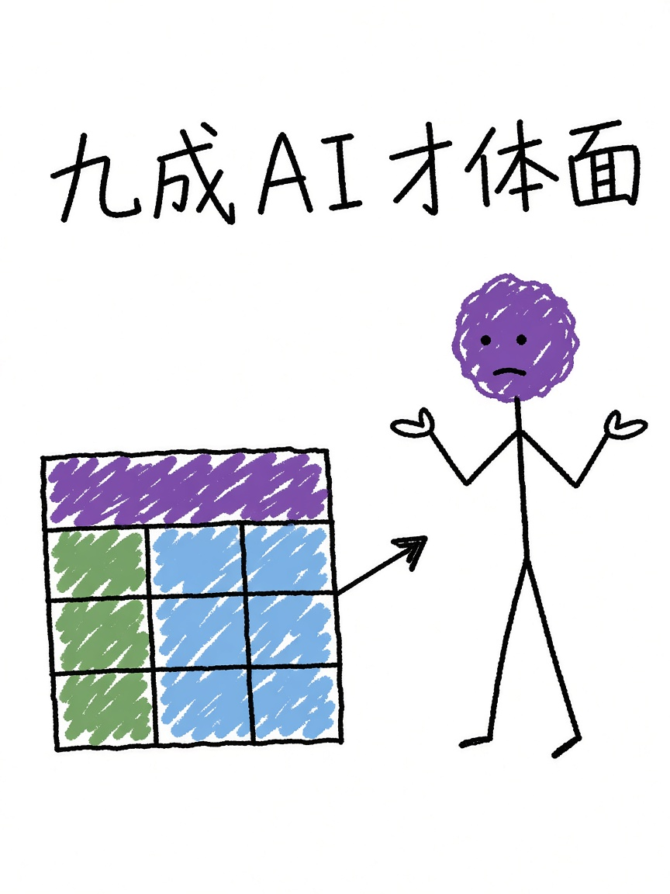

这两天刷到 Evan Merz 那篇，AI usage generates a fragile codebase，HN 上五百多条评论。他推测自己 5 月离开 Meta，跟不太热衷用 AI 写代码有关。可离职前他自己也说，至少九成代码是 AI 生成的，这是体面评级的下限，产出却没到两倍。我还没按他的标准去翻自己仓库。坦率的讲，我觉得最扎人的不是怕 AI，是行覆盖率刷得很漂亮，真正会出事的路径根本没测到。

Meta 这边，体面评级先卡一条，九成代码得是 AI 写的。他写，没到 2 倍。

怎么说呢，浅测试爱测 get/set。行覆盖率绿了，用户真实路径还是空的。

DRY 拧太紧，一个方法拆成两三个。最狠的是，有人把 hover 写成 mouseover 事件。

PR 越来越快，人只能扫一眼。仓库还在，懂它的人变少了。

事故从月底一个，变成周末常客。恢复也变慢，因为人进的是陌生代码。

你要是也在看吞吐、看覆盖率，这块可以先停一下，问一句测的是不是真人会走的路。
