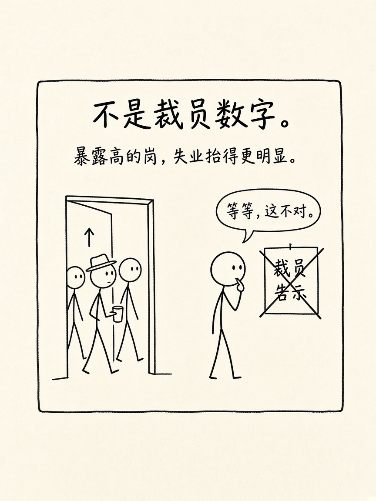
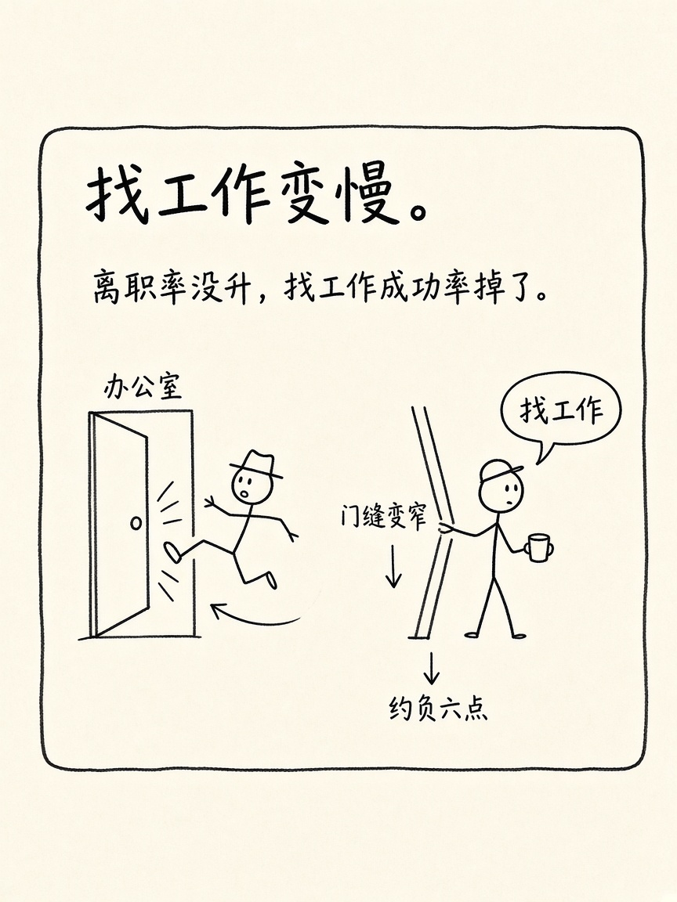
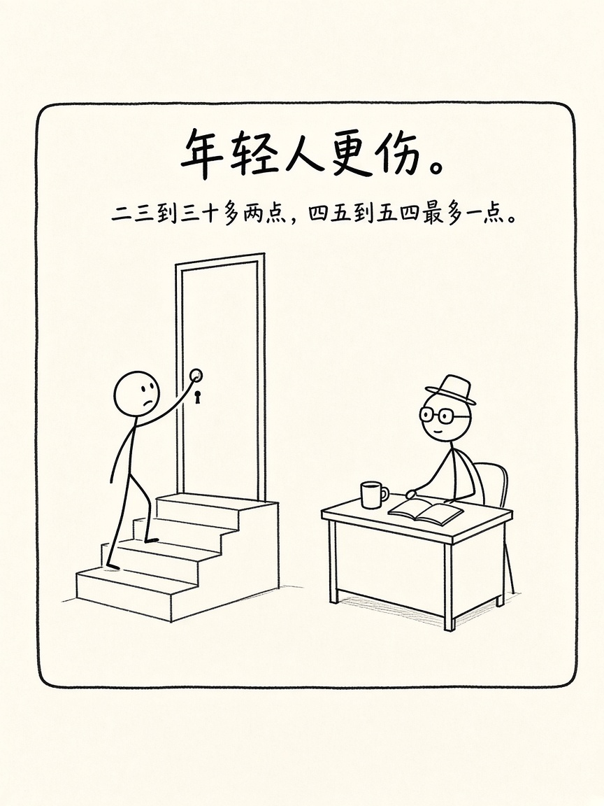
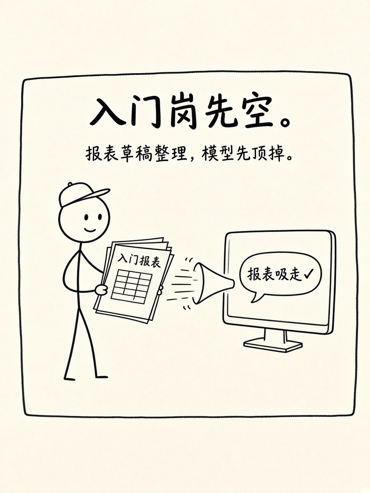
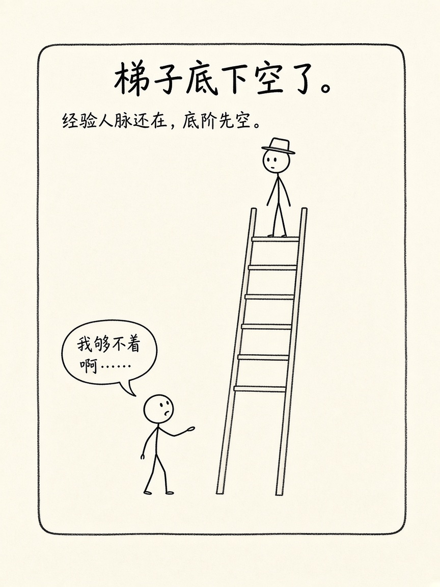
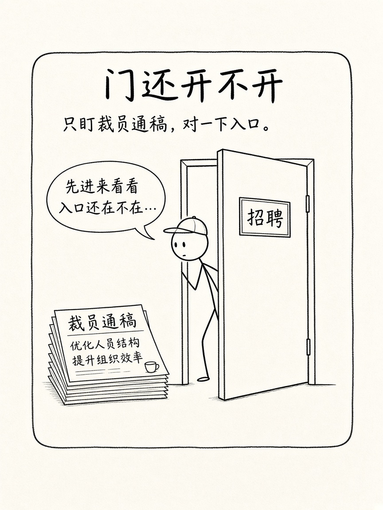

这两天刷到克利夫兰联储一篇评论，Job Finding and Unemployment in the Age of AI。他们拿美国劳动力调查对上职业的 AI 暴露度，比的是 ChatGPT 普及前后。我自己还没把那几张图逐格重画一遍。坦率的讲，我觉得最扎人的不是裁员数字，是 23 到 30 岁那一截，暴露越高，失业抬得越狠，人像在门口排队，门却越开越窄。

联储这篇，不是看谁被开掉，是看谁更难找到下一份。怎么说呢，暴露高的岗，失业率抬得更明显。

他们拆流量，离职率没有稳定升高。掉的是找工作成功率，高暴露比低暴露大约多掉 6 个百分点。

你敢信，23 到 30 岁从最低到最高暴露，失业大约多 2 个点。45 到 54 岁最多大约 1 个点。

年轻人抢的多是入门认知岗，报表、草稿、基础整理，ChatGPT、Claude 这类更容易先顶掉。

老人短期更不好替，经验、人脉、公司专用知识还在。梯子还立着，最底下那截先空了。

国内这边，应届生规模也大，初级岗同样挤。你要是只盯裁员通稿，这块可以对一下，门还开不开。
