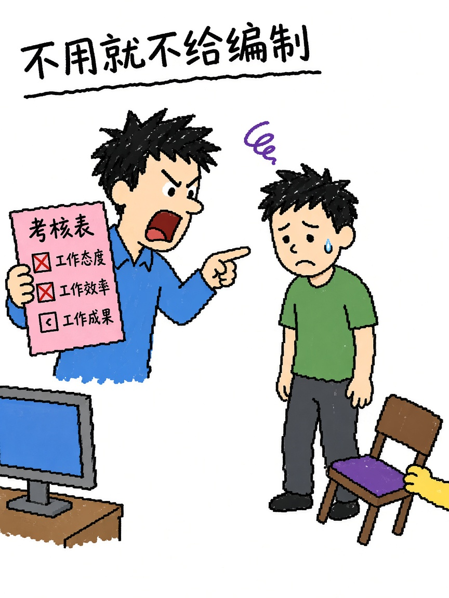

这两天把一篇裁员时间线翻完了，从 2023 年禁 ChatGPT 写到 2026 年秋天。顺序挺拧的，大公司先不许员工用，过了两年又把不用写成考核和招人的门槛，裁员公告里大面积写上 AI，又是更后面的事。我觉得值得拿走的是这张顺序，不是 AI 把人都替了这句话。坦率的讲，美国 2025 年公司自己归因于 AI 的裁员，大概只占宣布总量的一个零头。

2023 年春天，摩根大通限制员工用 ChatGPT，三星 5 月因为有人把代码传上去，禁了生成式工具。黑莓那年 8 月的调查说，大约四分之三的机构在落实或考虑禁令，主要怕泄密。你想想看，门关上了，人还是自己带工具进来，到 2024 年 5 月，工作里用 AI 的人当中，78% 用的是自己的。

2025 年 4 月到 8 月，备忘录挤在一起。Shopify 要求招人之前先说明 AI 为什么做不了，亚马逊的 Andy Jassy 6 月写，效率上来了，公司白领总数会减。微软开发部门的备忘录写，用 AI 不再是可选项。我自己的感受是，考核比禁令狠，禁令管的是工具，考核管的是你还在不在。

大规模把裁员理由写成 AI，是 2025 年四季度以后的事。美国 2025 年宣布裁员大约 121 万，归因于 AI 的是 54836，同一年最大的一栏是联邦那边的 DOGE，大约 29.4 万。牛津经济研究院说，记在 AI 头上的大约只占 4.5%。

2026 年上半年，美国裁员公告里 AI 写成了最常见的理由，大约 10.2 万，占两成出头。斯坦福用工资单看到的是另一头，22 到 25 岁、岗位最挨着 AI 的人，相对就业少了大约 13%，同岗位年纪大一些的还稳。公告可以全体换词，工资单先碰到的是刚入行的人。

到了 10 月，美国单月裁员大约 4.4 万，是 2023 年以来最低的 10 月，当月写 AI 的只剩 1265。欧洲到 11 月 6 日往前 100 天，宣布流失的岗位大约 18.1 万，比 9 月下旬那个 100 天大概翻倍。欧洲公司很少在正式理由里写 AI。

我没在裁员会上待过，美国那张表不敢直接套到国内。阿里 2025 年员工数少了大约 34%，百度少了近 7%，报道里的学者说更像招猛了之后往回收。川观新闻里的现场是，先要求高频用 AI，再告诉团队人可以少配。
