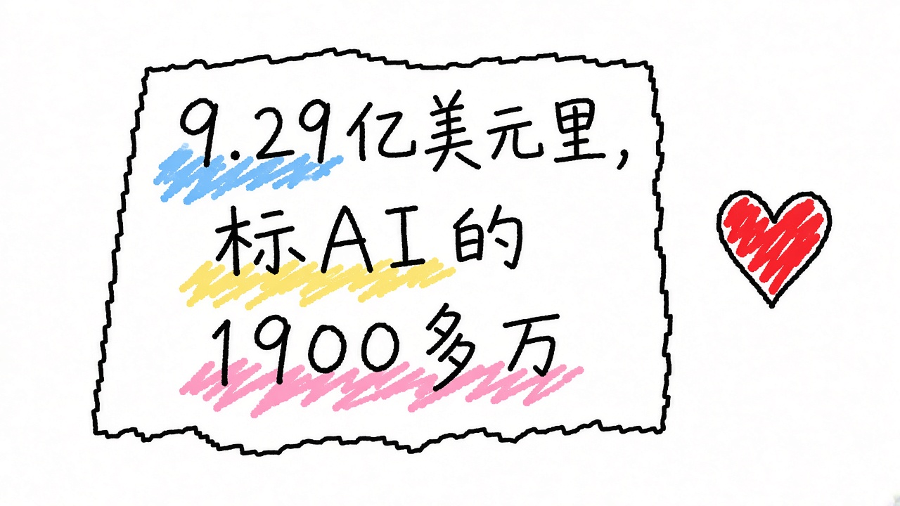
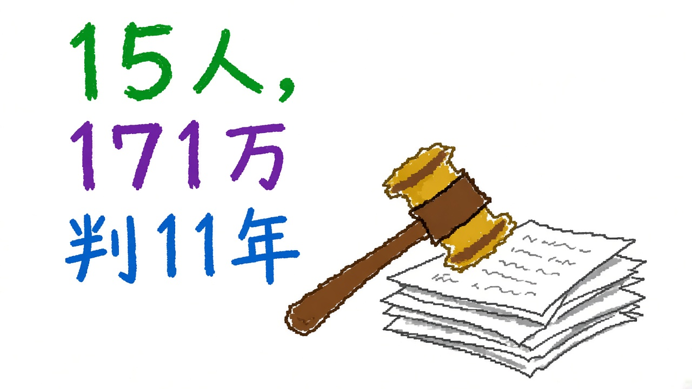
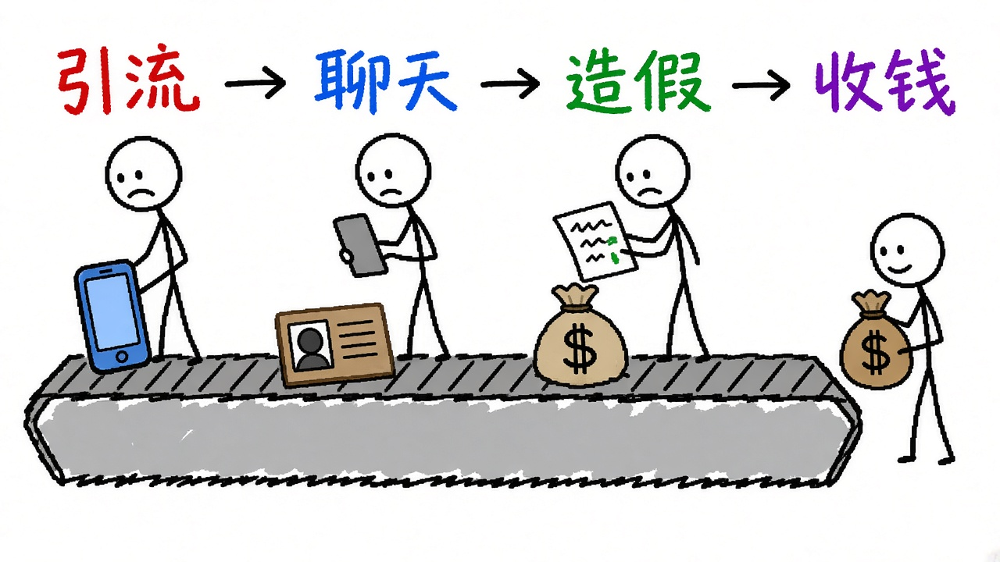
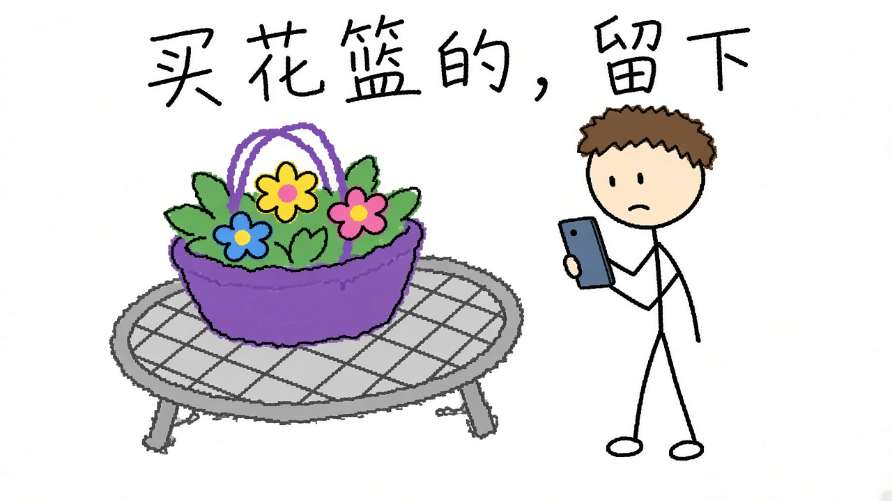
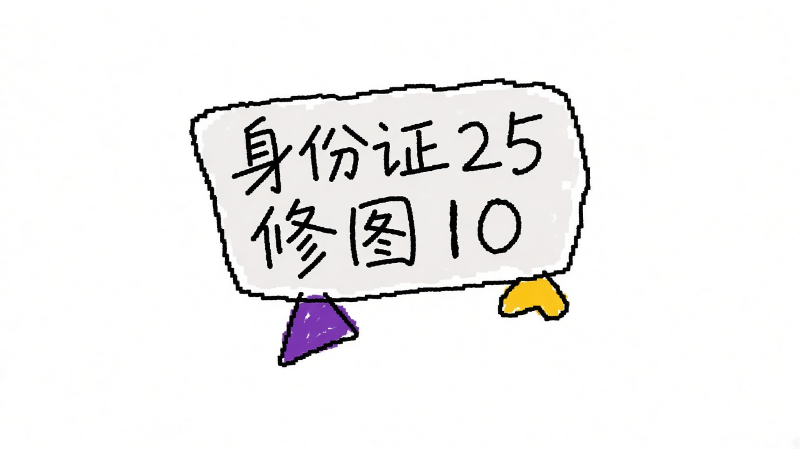
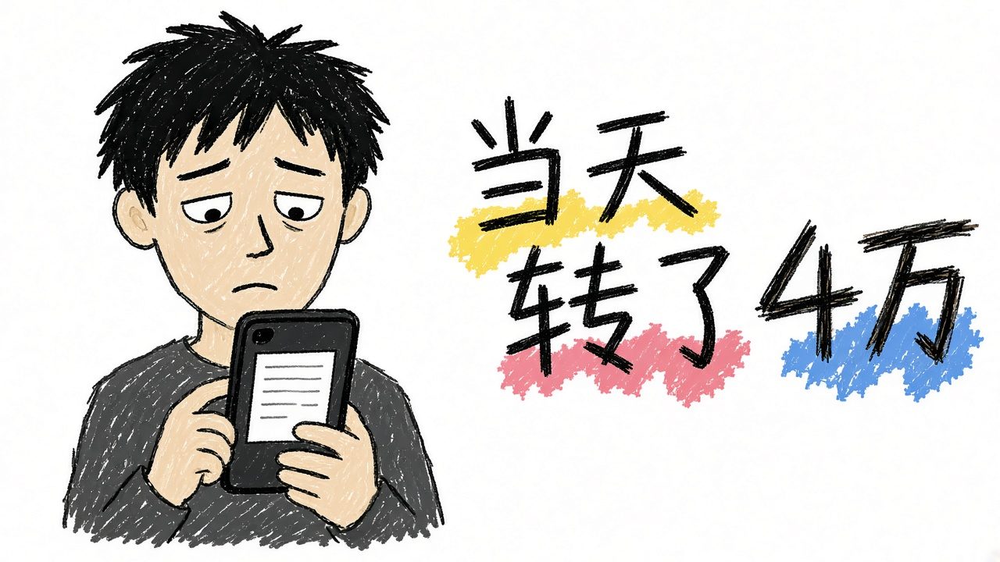
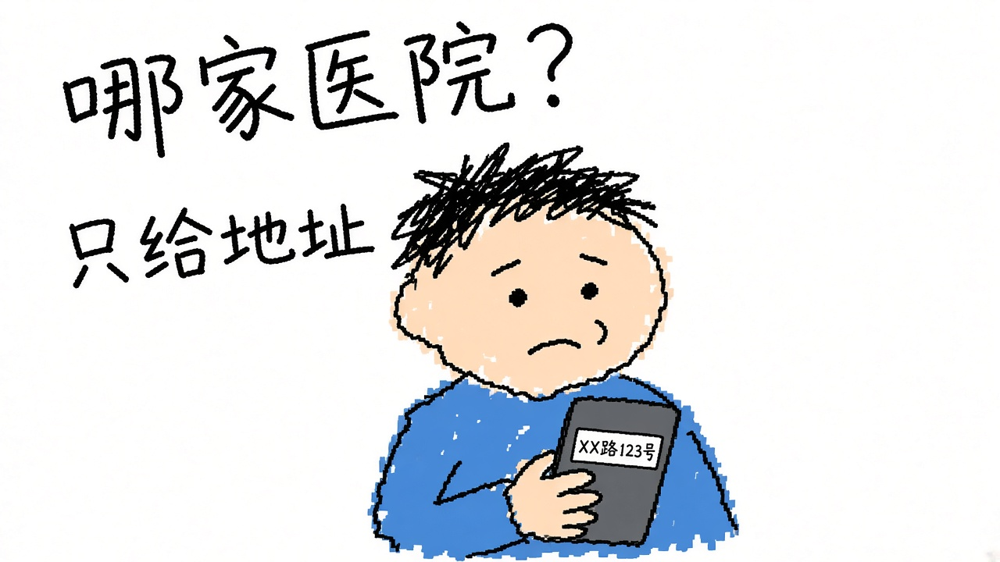

这两天央视把一起案子拆开讲了，网恋对象是 AI 生成的，15 个人被骗了 171 万多。我看的是检察院的通报，没看到判决书。有个细节我一直在想，AI 管的是脸和照片，真正把钱骗出来的，是一张七天的聊天剧本，还有一个几百块的花篮。我觉得大家容易盯着那张脸，其实该盯的是这套流程走到了第几天。

美国联邦调查局 2025 年的报告，网恋类损失 9.29 亿美元，标了跟 AI 有关的才 1900 多万。报告自己也说，这类合成内容越来越难认，所以我觉得那 1900 多万只能当下限。

央视写的是 180 余万，检察院通报写的是 171 万余元，我用检察院的数。杨某甲 2025 年 11 月 27 日被判有期徒刑 11 年。

通报里管这个叫流水线作业，养号引流，情感攻坚，骗钱收尾。AI 只在脸和照片上出场，证件和病历是另一个人伪造的，收钱转虚拟货币又是另一个人。

聊手手里有七天剧本，第三天还提醒自己人要自己打字，别直接复制话术。怎么说呢，脸做得再像，也怕聊天被看出是复制的。

聊手会说自己辞职开店，开业时希望你以男友身份送个几百块的花篮。愿意买的，往下聊。不买的，通讯录里备注成「某某（死）」，不再聊了。这是整套流程里最不讲感情的一步。

这是检察官助理在央视里说的价，伪造一个身份证 25 元，其他的图片修图一张 10 元。你想想看，哄人掏几万块的东西，成本也就一顿外卖的钱。

央视报道里的刘先生，一个月后收到姨妈脑瘤的诊断证明和身份证照片，当天转了 4 万，半个月累计 18 万多。案子里被骗最多的一位，38 万多。

刘先生转到没钱了，还办过小额贷款，才问了一句在哪家医院。对方不开实时视频，只发了个地址。我觉得能带走的就这个，别盯着脸，盯着剧本走到了第几天。
