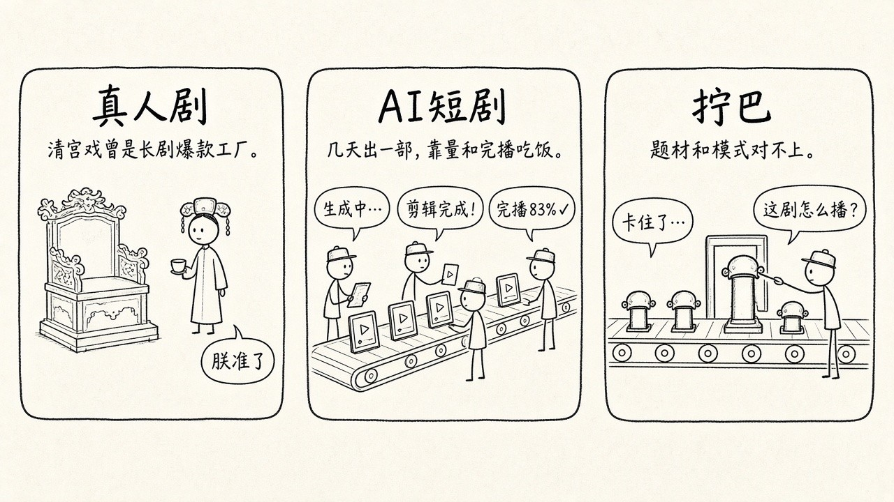
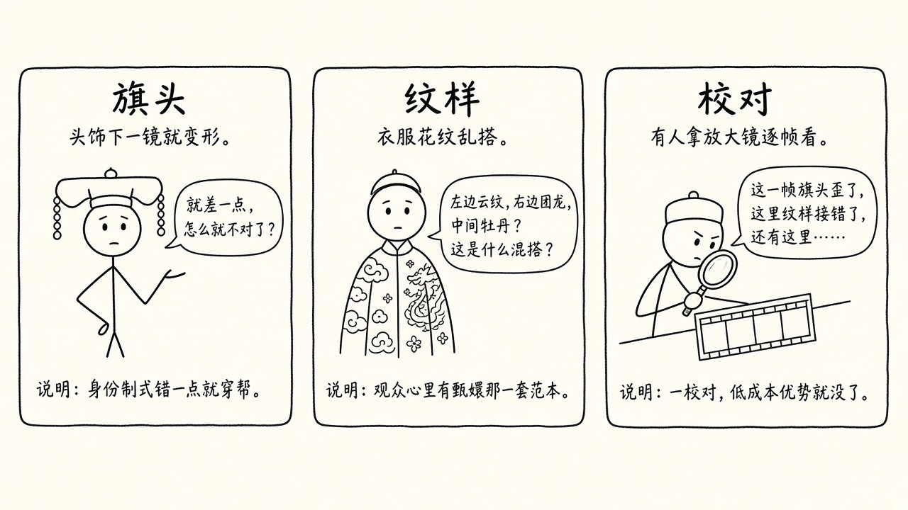
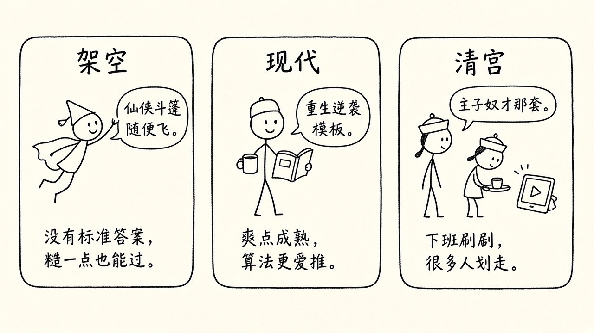
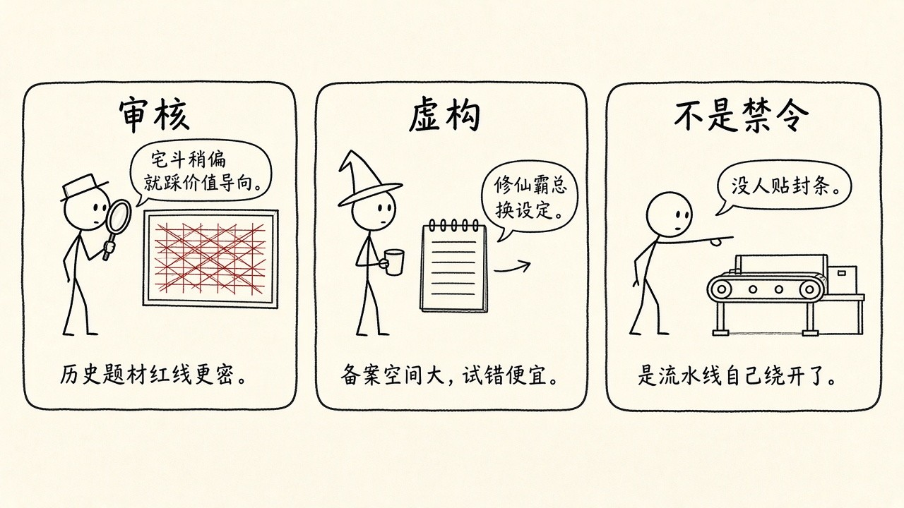
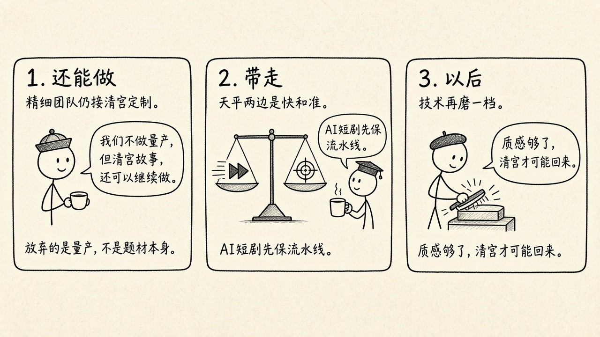

<!-- hand-drawn style: 1 -->

热搜问「AI短剧为何放弃清宫戏」。不是谁贴了封条，是旗头纹样一错就要人逐帧校对，几天出一部的流水线扛不住；架空修仙和重生逆袭没有标准答案，完播更稳。海外做历史戏服也常混搭朝代；国内创作者对着拇指选题，数据差就换赛道。放弃的是量产，不是题材本身。

清宫戏曾是长剧爆款工厂。AI短剧几天出一部，靠量和完播吃饭；旗头卡在传送带上，题材和模式对不上。

旗头、朝珠、纹样、请安，身份制式错一点就穿帮。观众心里有《甄嬛传》那一套范本；一配文史人员逐帧校对，低成本优势就没了。

玄幻架空没有标准答案，糙一点也能过。重生、修仙、豪门复仇爽点成熟，算法更爱推；主子奴才那套，下班刷剧很多人直接划走。

清宫属真实历史题材，宅斗稍偏就容易踩价值导向。修仙霸总换设定，备案空间大、试错便宜。没人贴封条，是流水线自己绕开了。

海外生成历史戏服，细节一多也容易混搭朝代。国内单部成本压下来后，创作者直接对着拇指选题，数据差就立刻换赛道。

有精细团队仍接清宫定制，放弃的是量产档。AI短剧先保流水线；技术再磨一档，质感够了，清宫才可能回来。
