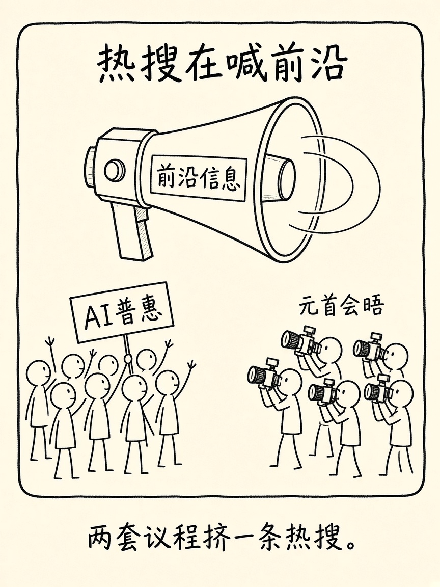
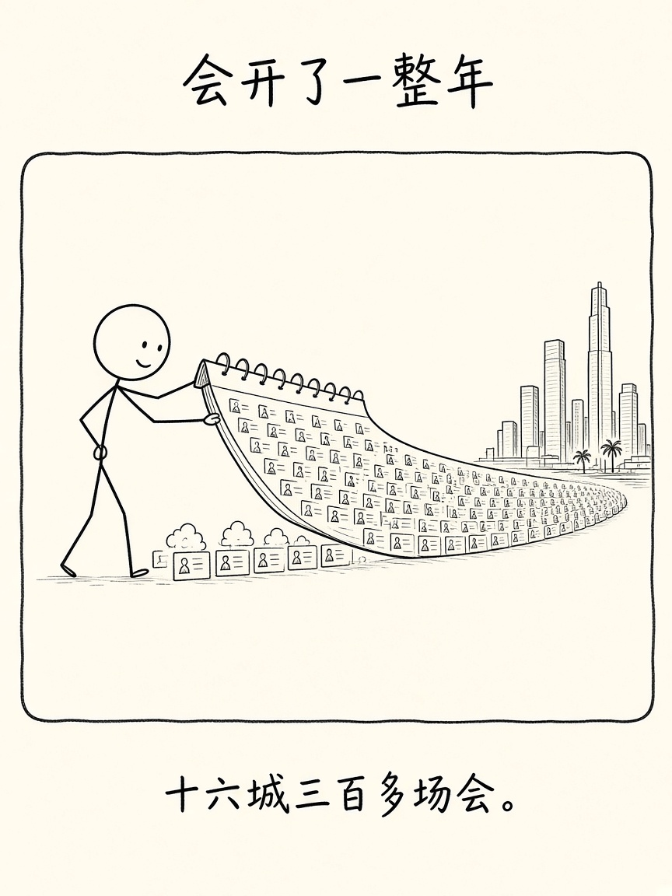
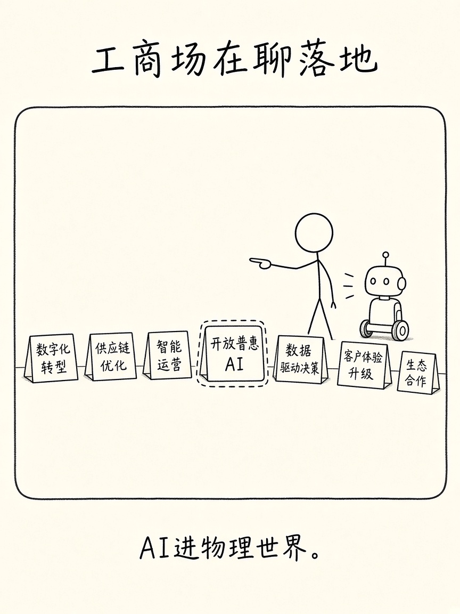
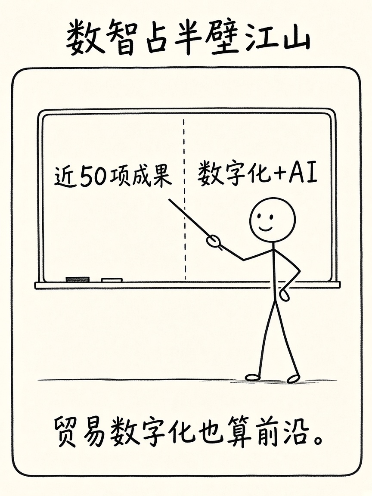
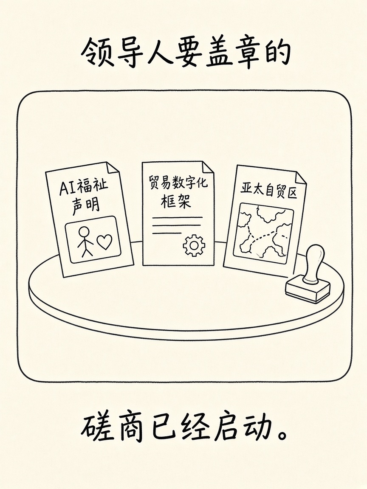
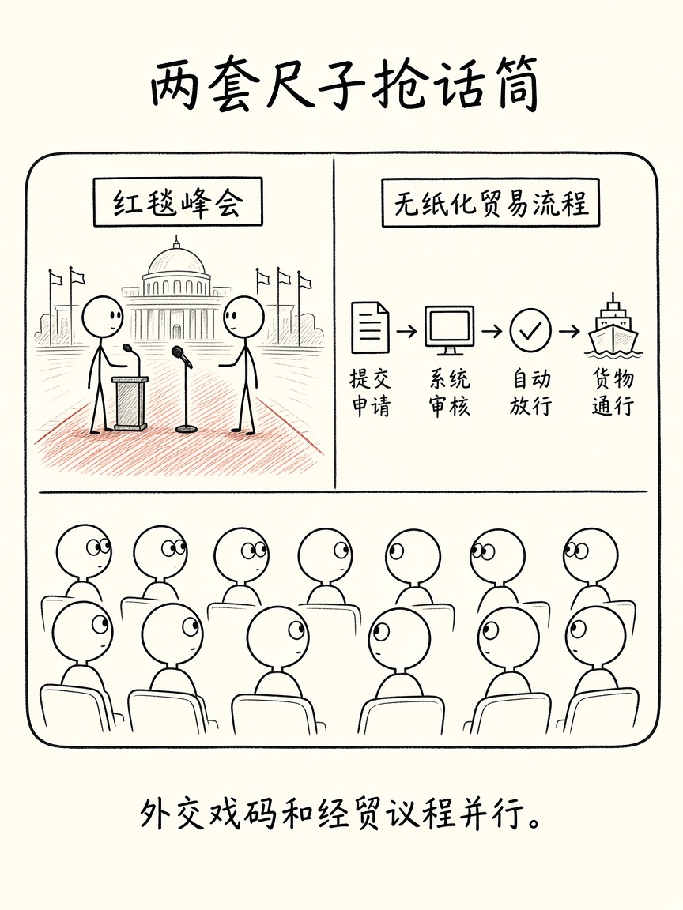
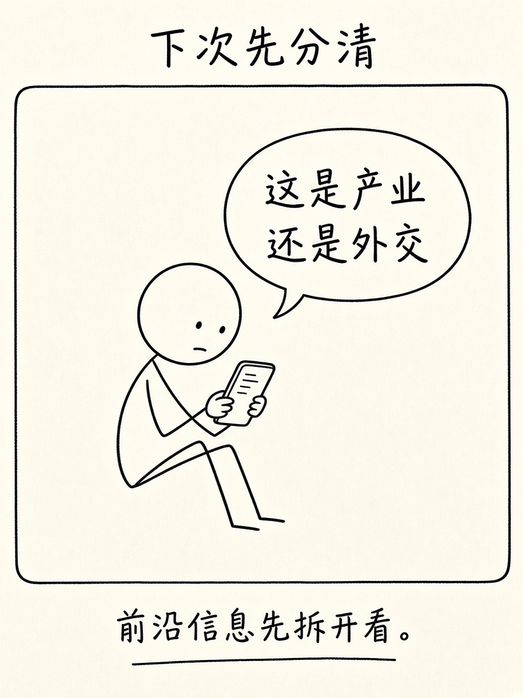

<!-- hand-drawn style: 1 -->

这两天刷到微博热搜，写着 APEC 多场密集对话释放大量前沿信息，热度蹭到八十多万。我自己没进新闻中心旁听。坦率的讲，我觉得热闹不在又多了几个新词，而在同一条热搜里，其实挤着两套议程，一套聊 AI 和贸易数字化，一套盯着元首会晤红毯。

一边是 AI 普惠，一边是镜头对准会晤。怎么说呢，两条线抢同一声喇叭。

官方说「中国年」在十六个城市办了三百多场会。深圳这周，是收口，不是突然冒出来的。

工商领导人峰会七个专题里，就有开放普惠的人工智能。雷军聊 AI 进物理世界，宇树聊算力，强脑聊脑机接口。我还没亲自试过那些产品，但场面已经不像纯务虚。

商务部吹风，今年中国与 APEC 经济体近五十项经贸成果，贸易数字化加人工智能大概占一半。你想想看，无纸贸易、电子口岸，这种听着很土的东西，也被算进前沿。

高官会那边，成果文件磋商已经启动。桌上飘着数字经济与 AI 福祉声明、贸易数字化框架、亚太自贸区相关文本。比较骚的是，前沿最后往往变成可盖章的几页纸。

同一周，屏幕左边是红毯和中俄美元首会晤预期，右边是贸易流程数字化。两套尺子并行，观众眼睛左右乱飞。

回到咱们刷热搜这块。我是真的觉得，下次再看见释放大量前沿信息，先问一句，这是产业议程，还是外交流量。
