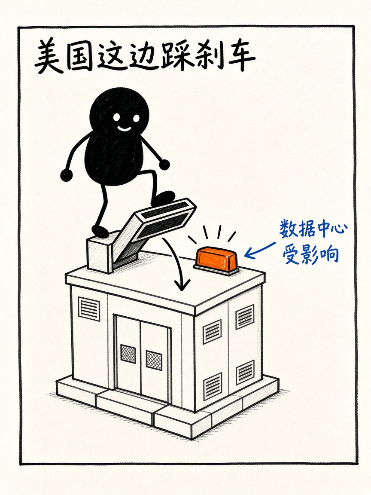
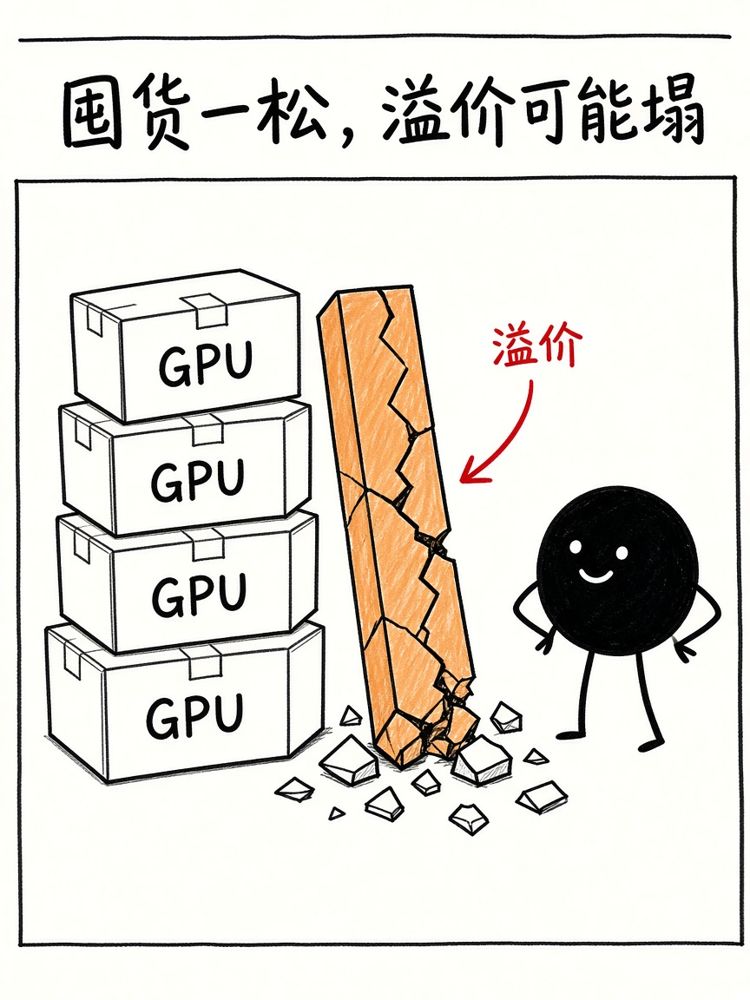
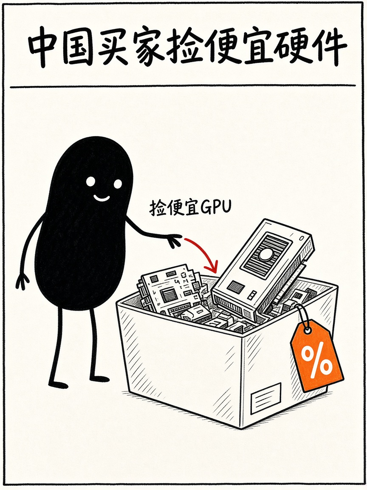
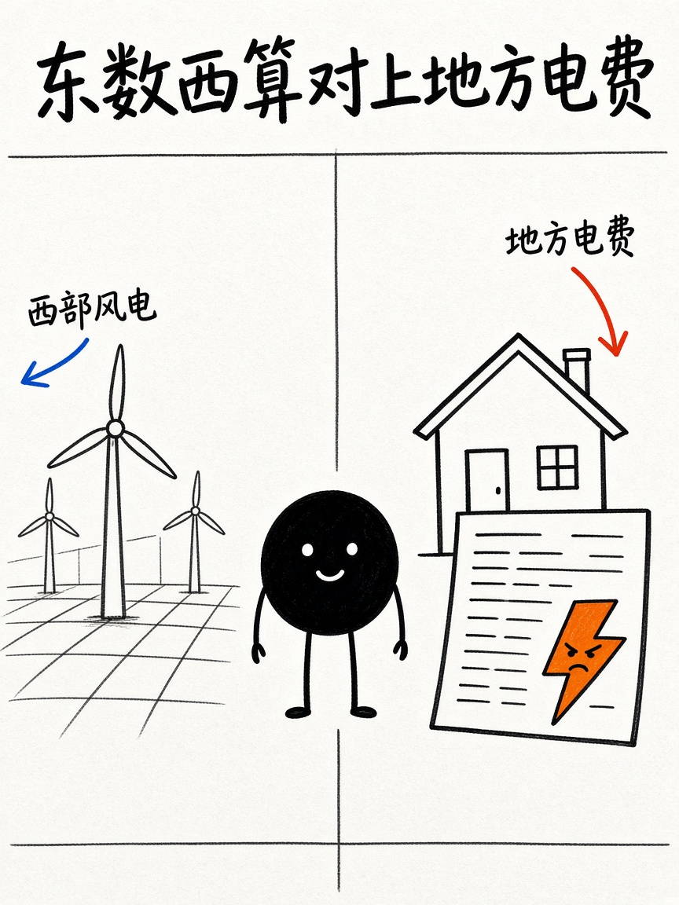
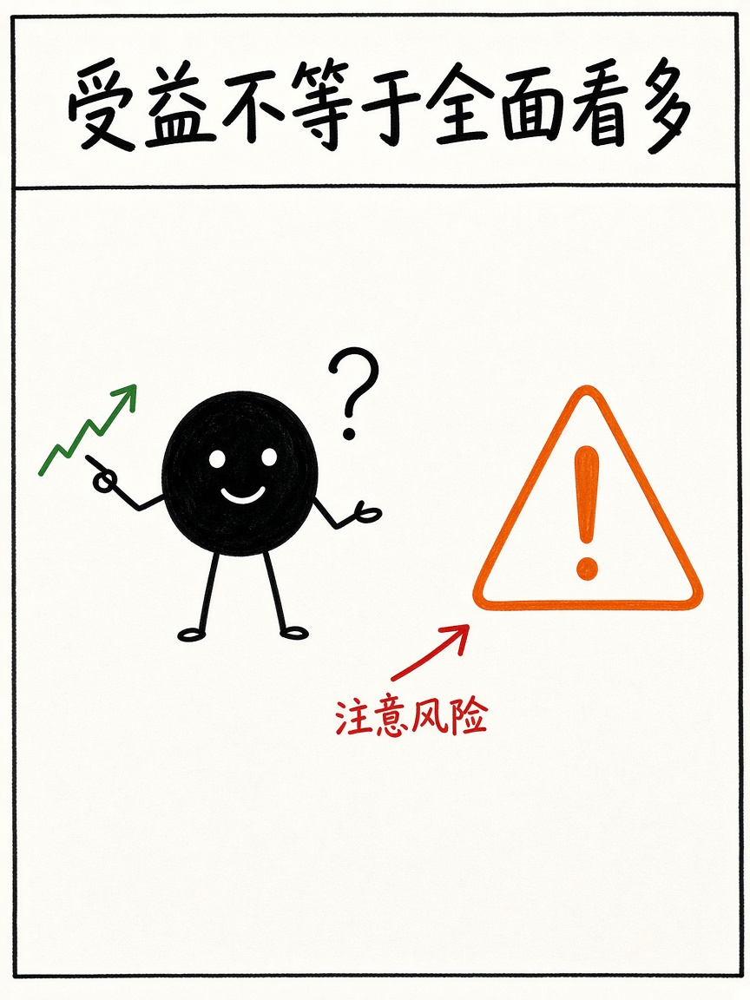

这两天又刷到华尔街见闻转野村那篇，民主党横扫两院之后，美国数据中心要变难建了，野村陆挺团队却说中国 AI 经济整体可能显著受益。怎么说呢，逻辑拧着看才有意思，美国这边审批和电价变严，全球 GPU、HBM 不那么被美云巨头囤死，亚洲枢纽里那些虚高的溢价就可能塌。坦率的讲，我觉得值得拿走的是这条链，不是民主党上台中国就赢了那句话。摩根士丹利还提醒，别跟依赖全球资本开支的出口链绑死，更看好自主可控。

野村写，新州长们盯着居民电费和企业问责，电网升级的钱不好再甩给住户。你想想看，选址保密协议、清洁能源硬门槛一上来，超大规模机房从选址到并网会拖很长。

美云巨头猛建的时候，全球 GPU、HBM 产能被囤紧，亚洲物流枢纽里相关模组溢价能到标价的两到三倍。我没蹲过那些货场，只是把报告里的数字摊开，需求一降温，投机溢价就站不住。

野村的判断是，中国 AI 企业、云厂和科研机构，可能更容易、更便宜地通过中间贸易枢纽拿到 GPU、HBM 和先进封装材料。建设变慢不是没人要算力了，是谁在抢货变了。

中国这边十五五规划里全国 AI 算力网络大约两万亿投入，东数西算由国家电网协调，西部枢纽直接吃低成本可再生电。美国卡在居民电价和并网排队，两边卡点根本不在同一层。

摩根士丹利说得更冷，民主党上台不等于中美技术竞争变软。跟全球 AI 资本开支绑在一起的供应链，还是会跟着美国节奏抖；国产芯片、算力、电力设备，更多听自家政策供需。

野村也提过，美国放缓可能伤到部分中国 AI 出口商，但很多对美敏感件本来就禁着，实际冲击可能没账面那么大。我自己的感受是，这是一张分工表，不是一张全线加仓单。
