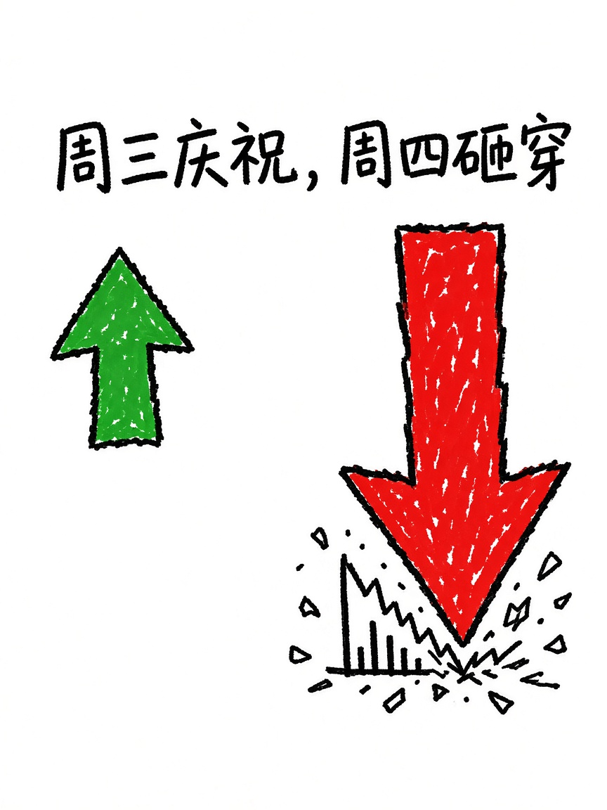
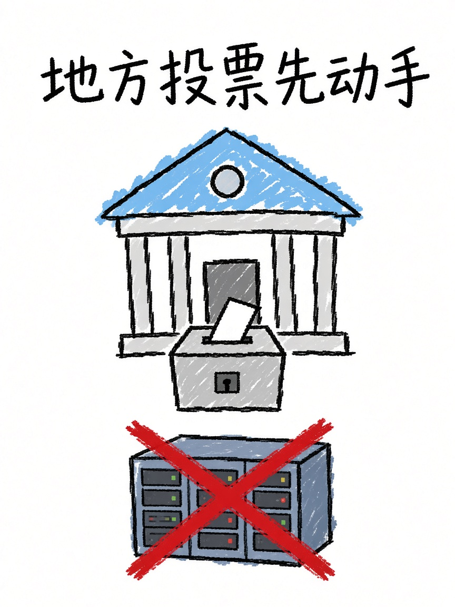
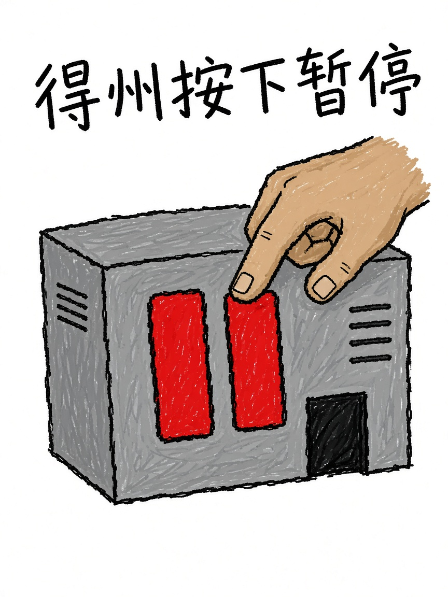
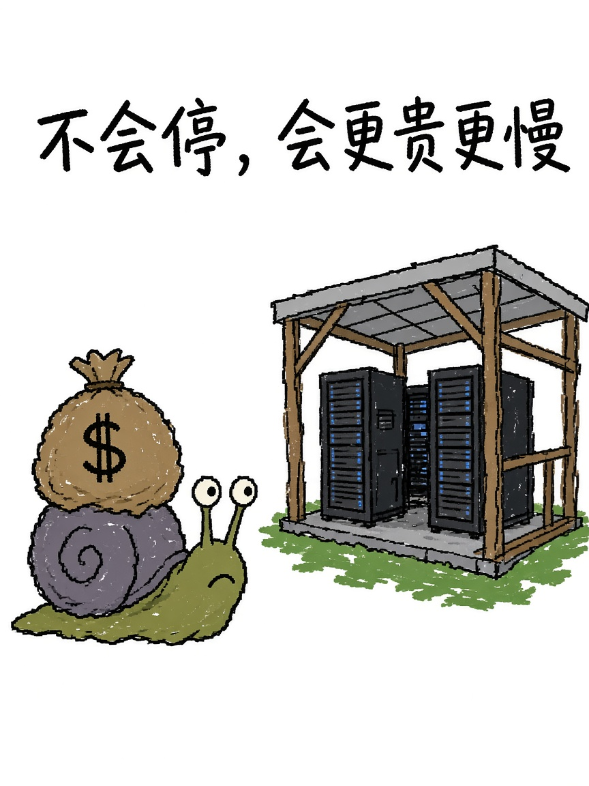

这两天刷到华尔街见闻那篇研判，民主党重掌两院之后，AI 股先被当确定性庆祝了一下，第二天又被砸穿。坦率的讲，我觉得市场砸的不是算力突然没人要了，是数据中心可以一路建下去、不用过选票这套信仰。巴克莱写得很直，建设大概不会停，但会更贵、更慢。读完我想带走一张分工表，地方在卡审批和电，联邦全国禁建还不像真事，国内也别把美股 AI 跌了和自主可控当成同一笔交易。

怎么说呢，选举结果落地那天标普还涨了，隔天纳指一天跌大约 6.4%，是疫情以来最大单日跌幅之一。确定性刚庆祝完，仓位就开始互相踩。

全美 47 项跟数据中心有关的地方投票里，44 项选择限制，分区、暂停、禁止新建都有。你想想看，震中其实在市政厅，不完全在华盛顿。

得州候任州长说要先暂停新数据中心审批，等电力、水和社区规则立住。得州加佐治亚，大概占美国 AI 数据中心支出三分之一。我没去过这些工地，只是把数字摊开看，位置太集中了。

巴克莱的判断是，全国性禁建不太可能，总统否决还在。我自己的感受是，竞选纲领和市场在讲两套规则，真砸到项目上的，多半是审批和地方用电变难。

竞赛从大家抢着建，变成谁更能扛延期。已经通电或快通电的机房更稀缺，超大规模云厂资产负债表更厚，还在图纸上的新玩家更难受。这就是他们说的消耗战。

摩根士丹利提醒过，民主党对华技术竞争不见得更软。跟全球资本开支绑在一起的供应链，还是会跟着美国节奏抖；国产芯片、算力和国内基建，更多听自家政策。我觉得值得拿走的是这张拆法，不是跟跌跟涨那句口号。
