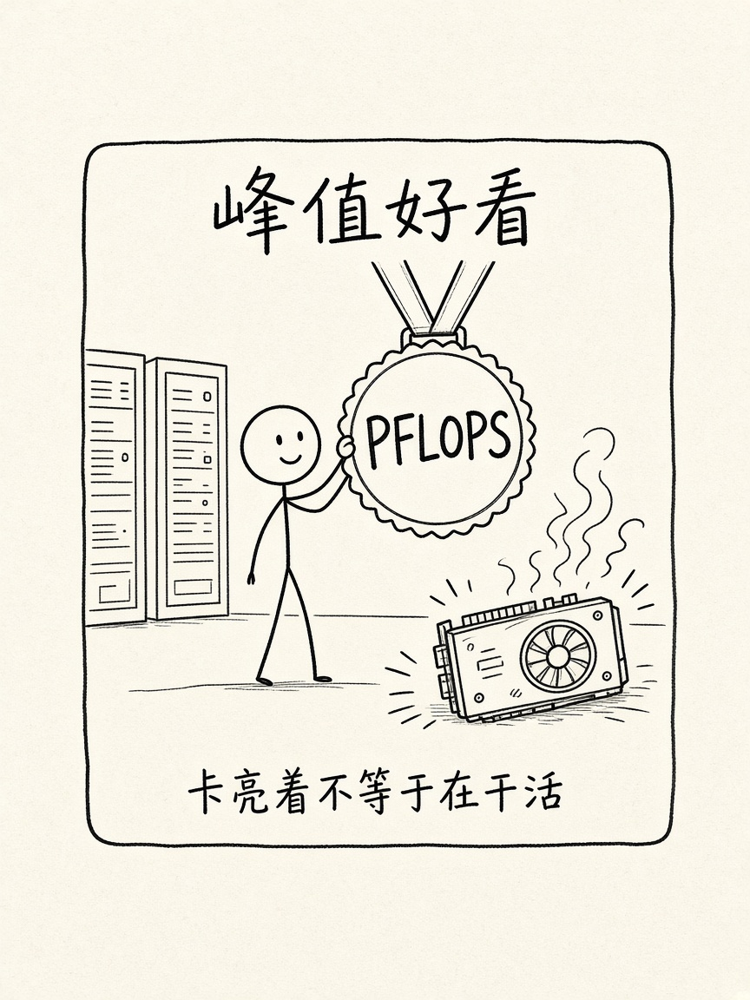
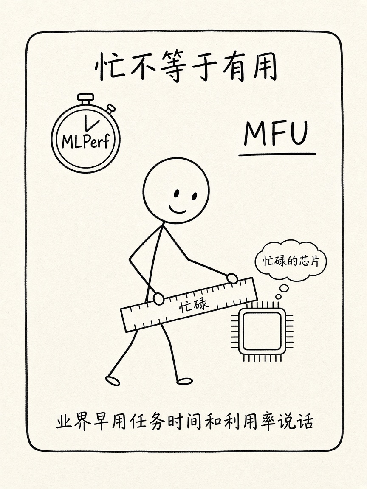
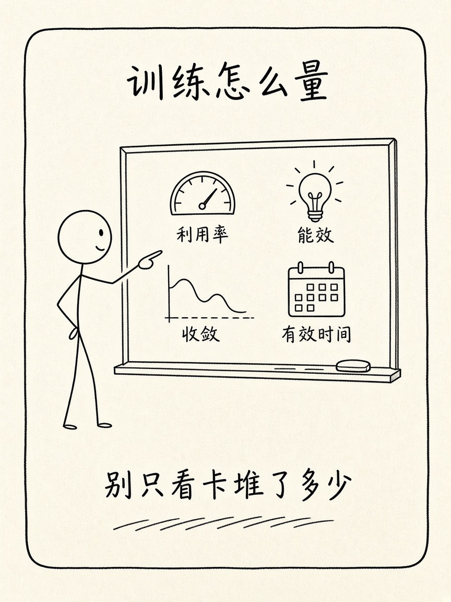
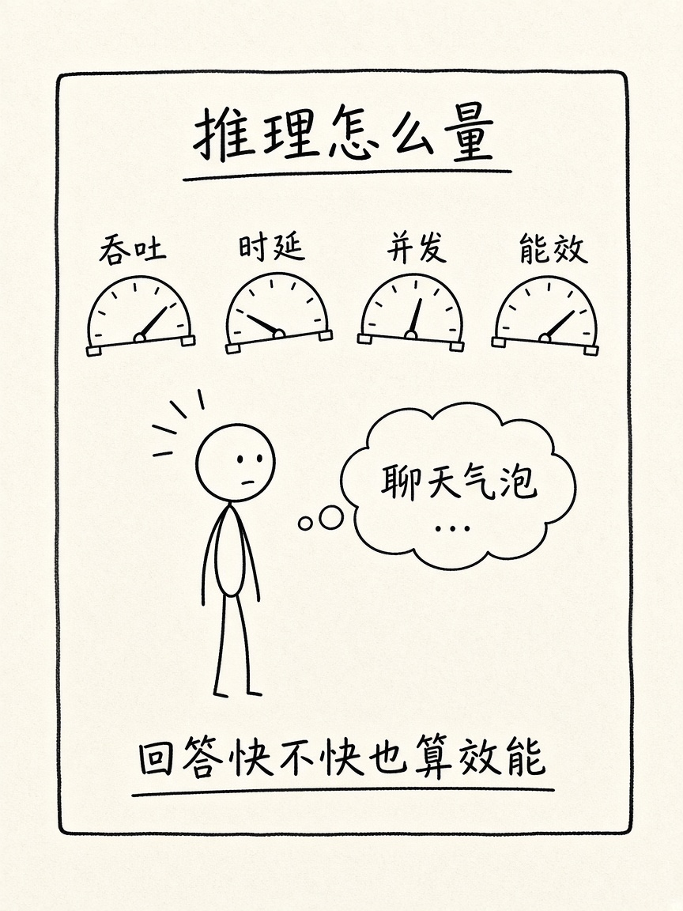

<!-- hand-drawn style: 1 -->

这两天刷到市场监管总局一条通稿，《智能计算集群效能指标与测试方法》批出来了，标准号是 GB/Z 328-2026。我自己还没打开全文逐条对公式。坦率的讲，我觉得热闹不在多了一份文件，而在它把话说明白了，峰值算力好看，不代表集群真在干活。

国外机房宣传册爱写 PFLOPS。卡亮着，奖牌挺大，底下可能在空转等通信。

怎么说呢，业界早就用 MLPerf 比任务时间，用 MFU 看模型真正吃掉多少峰值算力。忙着不等于有用。

国内这回出的是指导性技术文件。之江实验室、阿里云、信通院这些单位一起起草，面向大模型训练和推理。

训练侧要看模型算力利用率、训练能效、收敛速度、有效训练时间占比。别只数卡堆了多少。

推理侧盯吞吐、时延、并发、计算能效。你问一句模型回得慢不慢，也算效能。

异构混着训还有混合训练效率、能效损失比。比较骚的是，损耗往往藏在缝里。

回到咱们刷到的万卡叙事这块。我是真的觉得，下次听见峰值，至少多问一句，利用率测了吗。
