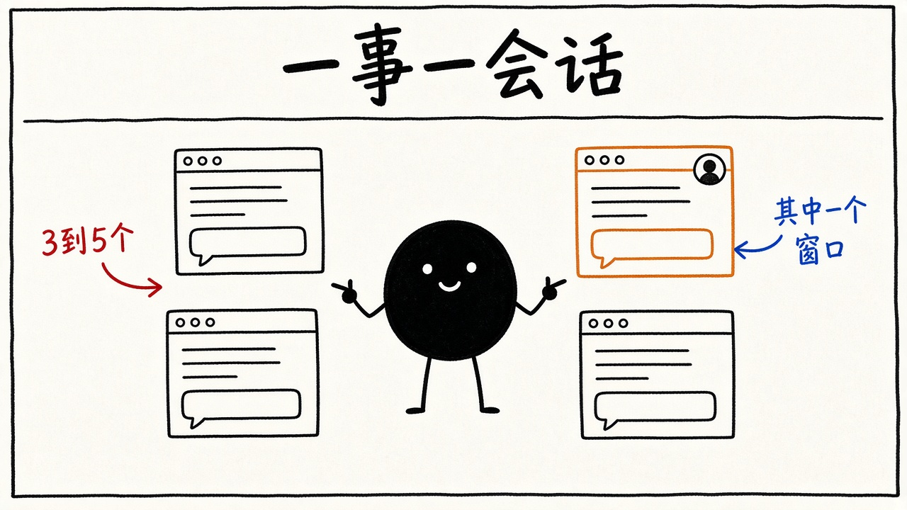
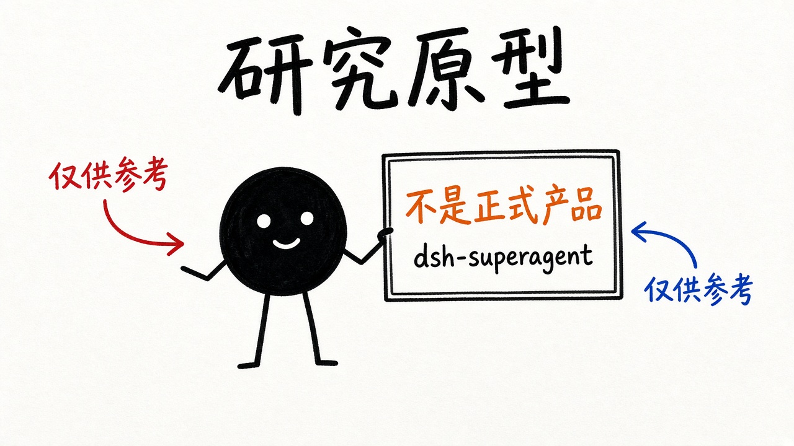
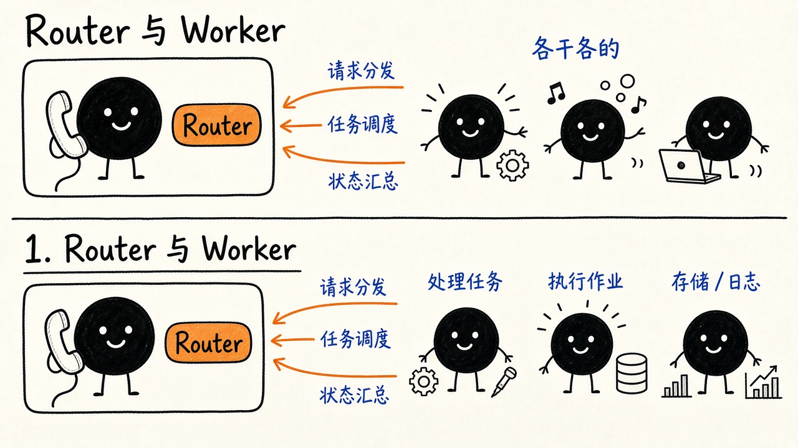
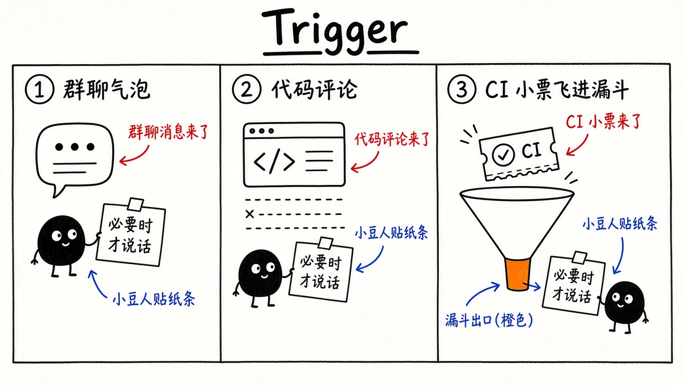
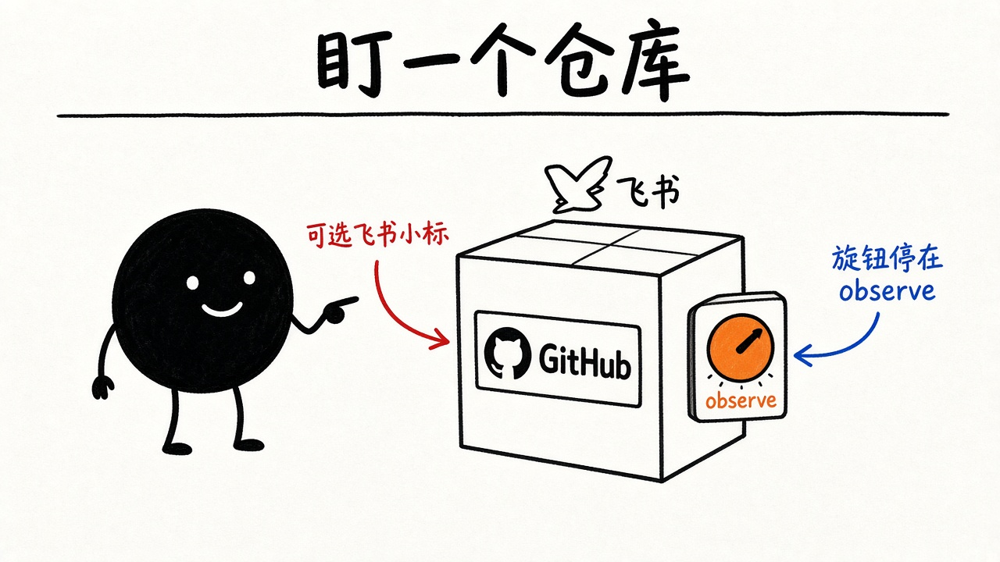
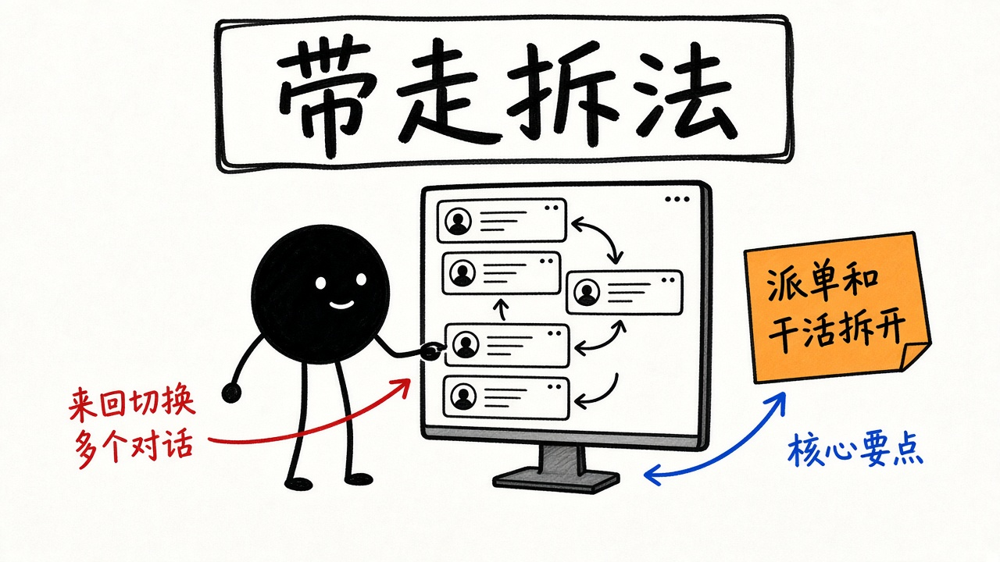

这两天刷到 DeepSeek Harness 发的 Super-agent 设计探索，同天还开了个 MIT 仓库，叫 `dsh-superagent-prototype`。坦率的讲，我自己还没把这原型跑起来。但那个拆法挺戳我，Router 跟人聊、记全局、再分活，Worker 在隔离会话里闷头干，不直接回你。仓库自己也写了，这是研究原型，不是正式产品。

你想想看，国外主流编程 Agent 多半还是一事一会话。团队写，人通常只能同时跟进 3 到 5 个活跃窗口。我寻思了一下，卡点好像不在模型够不够聪明，而在人到底盯得住几个聊天框。

当晚上线的就是这个原型仓，MIT。README 写明仅供参考，和文章里那套设计也不完全一致。不是哥们，先别当成品装进生产仓库。

怎么说呢，Router 像前台，维护全局上下文，再把活派下去。Worker 挂更强的模型干活，结论交回 Router，由它统一对外说。比较骚的事是，干活的那位默认不跟你直接唠。

群聊、代码评论、CI 结果，他们管这些叫 Trigger。他们自己写，尽量少占人注意力，规则允许才主动干。我是真的觉得，这句话比再吹一个模型名更要紧。

原型就盯一个 GitHub 仓库，可选再接飞书。主动模式分 off、observe、auto，默认停在 observe。说实话我也不确定自己会不会把它拧到 auto，至少先看它观察什么。

国内写代码的朋友其实一样，窗口切来切去。反正我觉得，能带走的是派单和干活拆开这件事，不是换个更响的模型名。
