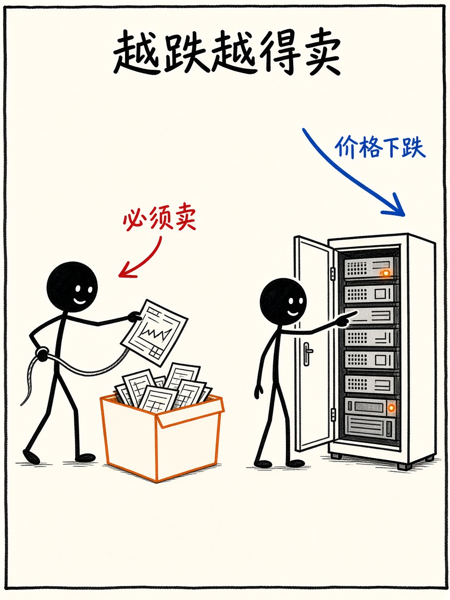
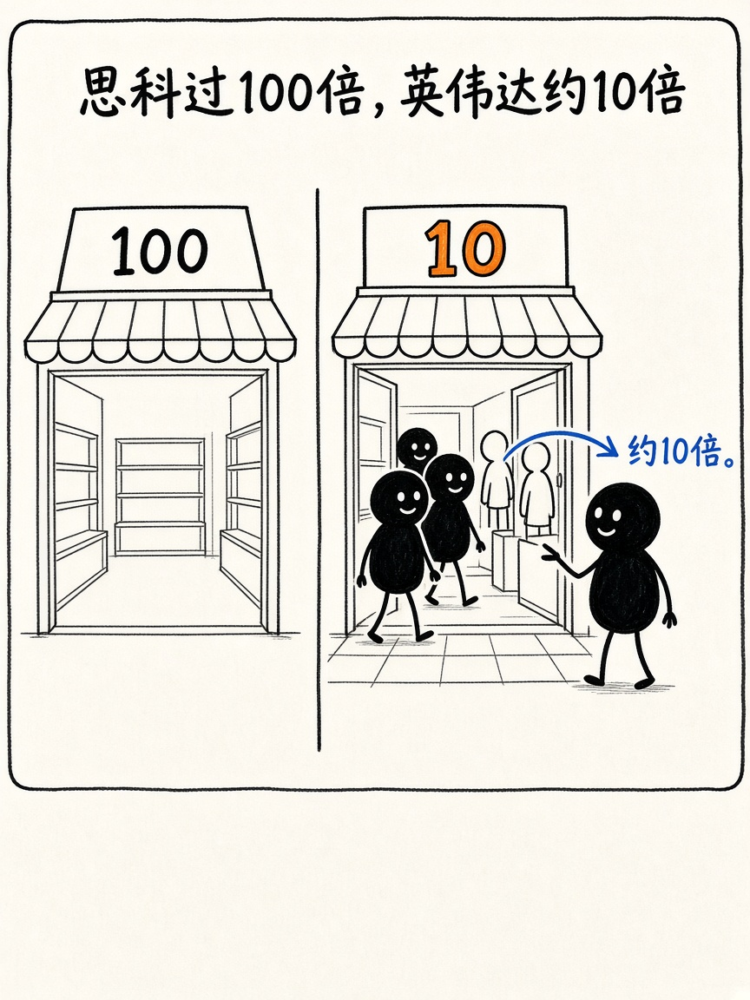
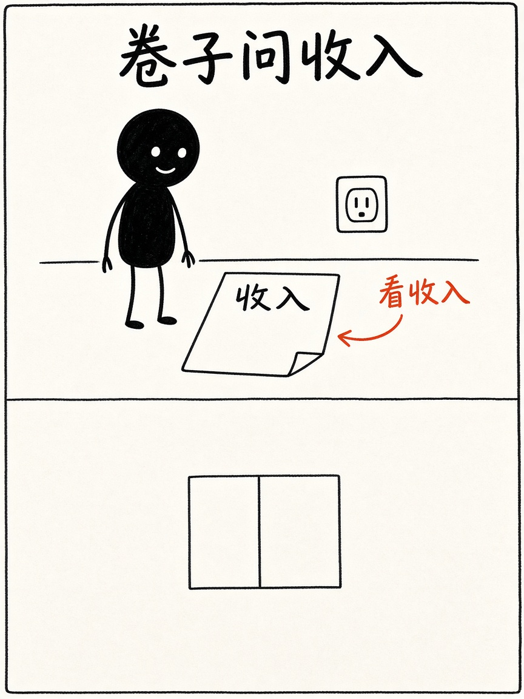

这两天美股科技股跌得有点离谱。11月5日那天，纳斯达克掉了5.5%，费城半导体指数掉了12%，标普500掉了4.4%。高盛管股票和固收的 Rich Privorotsky 第二天写了份日更，说他更想把这轮当成1998年的流动性冲击，不是2000年泡沫破掉的开头。我觉得这个分法有用，但坦率的讲，剧本后半场对不上，1998年紧接着是美联储降息，这次市场还在给加息定价。我没看到他的原始日更，数字来自华尔街见闻和鉅亨网的转述。

选举之后，市场开始重算数据中心还能不能按原计划建。得州候任州长说她不恨数据中心，盘里已经按停建在卖了。你想想看，再叠上杠杆基金收盘前必须减仓，越跌它越得卖。

1998年是俄罗斯国债违约，再加上一家叫长期资本的对冲基金，杠杆高到差点把借钱给它的银行拽下水。美国自己的增长没坏，格林斯潘七周里降了三次息，市场后来涨回去了。Privorotsky 觉得现在 AI 的需求也可能还在，市场重新算的是建数据中心的钱和进度。

2000年很多公司还没有真正的收入。高盛的 TMT 交易员说，英伟达未来两年的市盈率大概10倍，是2013年以来最低，当年思科超过100倍。我自己的感受是，有客户上门，和店还没开张，根本不是一种跌法。

他列了四样担心，钱够不够建，收入对不对得上投入，电和批文够不够，花钱的速度能不能持续。市场盯得最死的是电，他觉得这反而是最不急的，供给卡住不等于没人要。超大规模云厂商今年发债大约2960亿美元，数据中心债务的违约保护周四创了新高。

这块需要注意一下。1998年能涨回去，有一段是央行把水放出来，这次鉅亨网写市场还给12月加息留了大约六成五的定价。资本开支要是真被推迟，收入又对不上，他自己也说该改看2000年，借新还旧先失败的话，这场跌的性质就变了。

我没在看盘，国内算力这条链走到哪，我也不敢装知道。电和批文最好讲，收入和借来的建设钱更难讲。他点名往台积电和阿斯麦靠，那是他的质量偏好，不是买什么的建议，原始日更我也没亲自核对。
