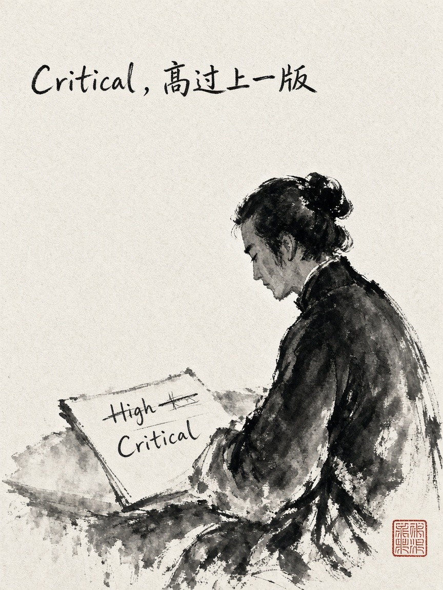

事情是这样的。11月5日，OpenAI 发了 GPT-6 Cyber，网络安全能力从上一版 GPT-5.6 Cyber 的 High 调到了 Critical。我刷到后半段才愣住，他们单独写了电厂和水厂底下那套工控。Dragos 在发布文里讲，一座模拟电厂，一个几乎没人讲解的前沿模型，自己把设备拣开，还找到两个以前没公开的洞。我觉得该记住的是地图和围栏同一天都在。我还没亲自试过，普通账号进不去。

GPT-6 Cyber 是 11月5日发的，做的是授权范围内的安全研究。Critical 你就当成他们准备框架里的能力档，上一版还是 High，他们说调档是因为这模型更能看懂软件、找出洞、再做出能跑起来的利用。坦率的讲，这个调档我是当真的。

他们写的关键基础设施，就是电厂、水厂，还有操作技术，口头常叫 OT，管的是泵、阀门、开关，不是你桌上那台办公电脑。你想想看，办公网出了事，多半是文件。这层要是被乱动，灯和水才真会停。

OpenAI 转了 Dragos 首席人工智能官 Rob Lee 的话，洞出在管继电保护数据的工程软件里，保护定值和断路器怎么跳都能被看出来。零日就是还没公开、补丁也还没落地的洞。这句话没点名就是 GPT-6 Cyber，我读的时候差点听拧。

一笔 10 亿美元的 Daybreak 前线防守补助，补贴缺钱的政府机构，还有水、电这类关键服务单位去用。同一篇里又开了一组，叫关键基础设施的 Daybreak Red，过审的防守方可以在授权范围内测这些系统，防着模型自己跑偏的那层还留着。我跟你说，能看的人和被允许看的手续，是一起写上的。

他们自己写了，拦截率不是越高越好，因为看懂设备、找洞、验证补丁，防守的人也得会。你敢信？？？同一套动作，过审就放行，没授权就往外拦。这地方拧着，我看着是想笑的。

这模型先只给少数过审的 Daybreak Red，走接口和 Codex，Codex 就是他们那个写代码的产品，还得单独审批。门上挂着身份核验、登录要再验一次、接口只能从登记过的网络地址进来。工控上的高风险协助他们额外拦了一层，我还没亲自试过，这些是发布文和系统卡里写的。

电厂和水厂在国内，就是关键信息基础设施里最常被点到的两类。2021年9月1日施行的《关键信息基础设施安全保护条例》写了，没有国家网信部门或国务院公安部门批准，也没有保护工作部门、运营者授权，就不能对关基做漏洞探测和渗透测试。怎么说呢，外面是模型也要一张红牌，咱们更早先问的是人有没有这张纸，我没把两套制度说成同一套。
