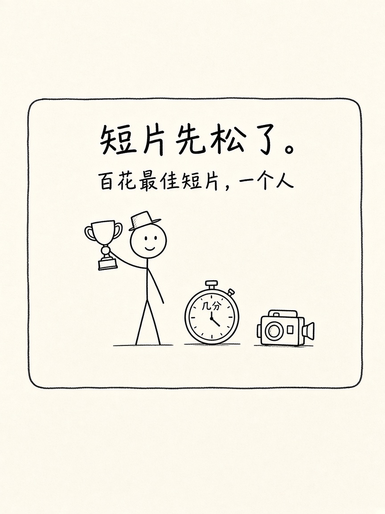
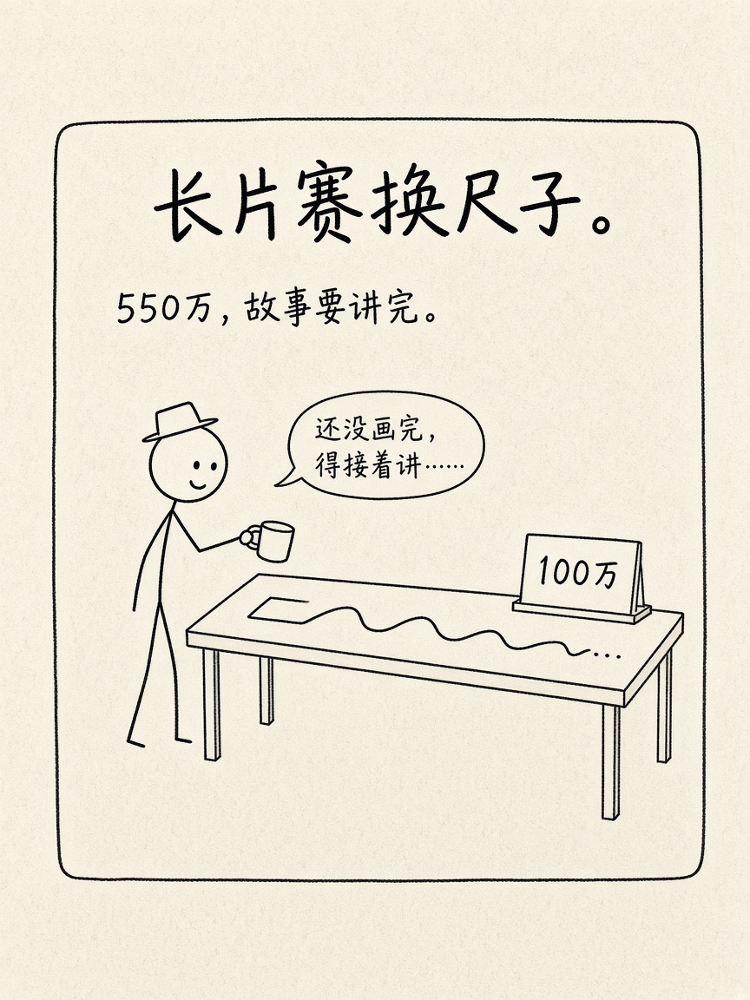
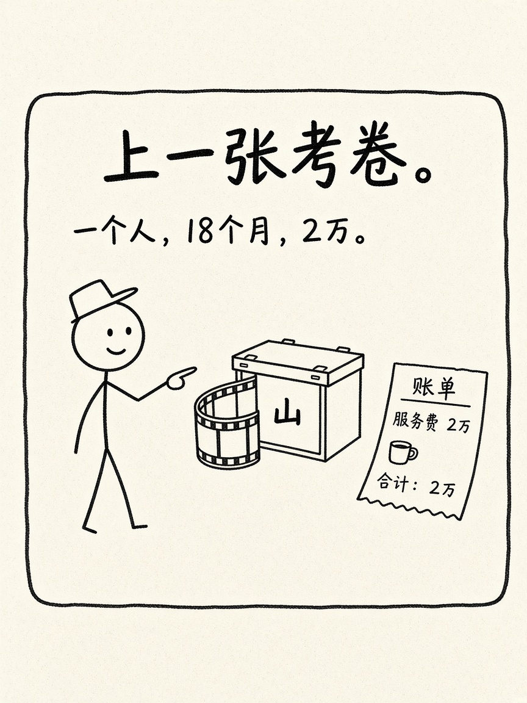
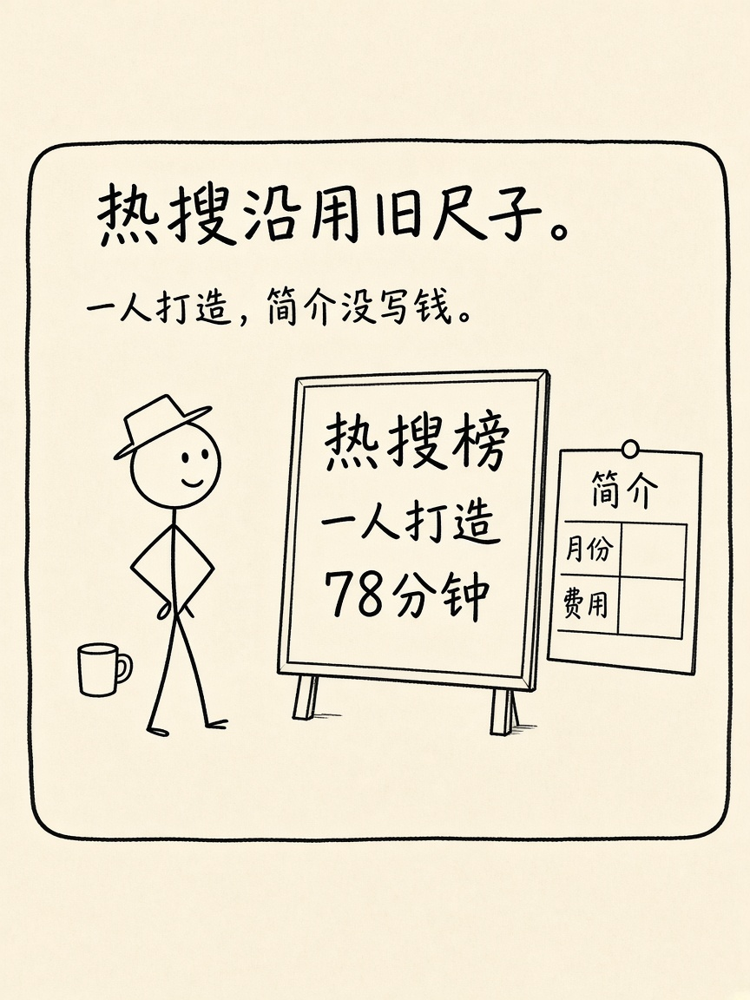
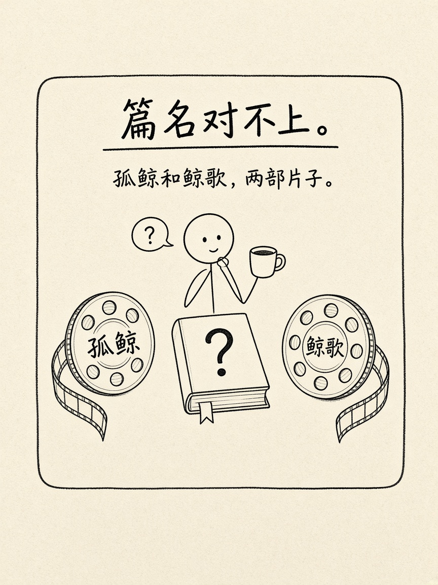
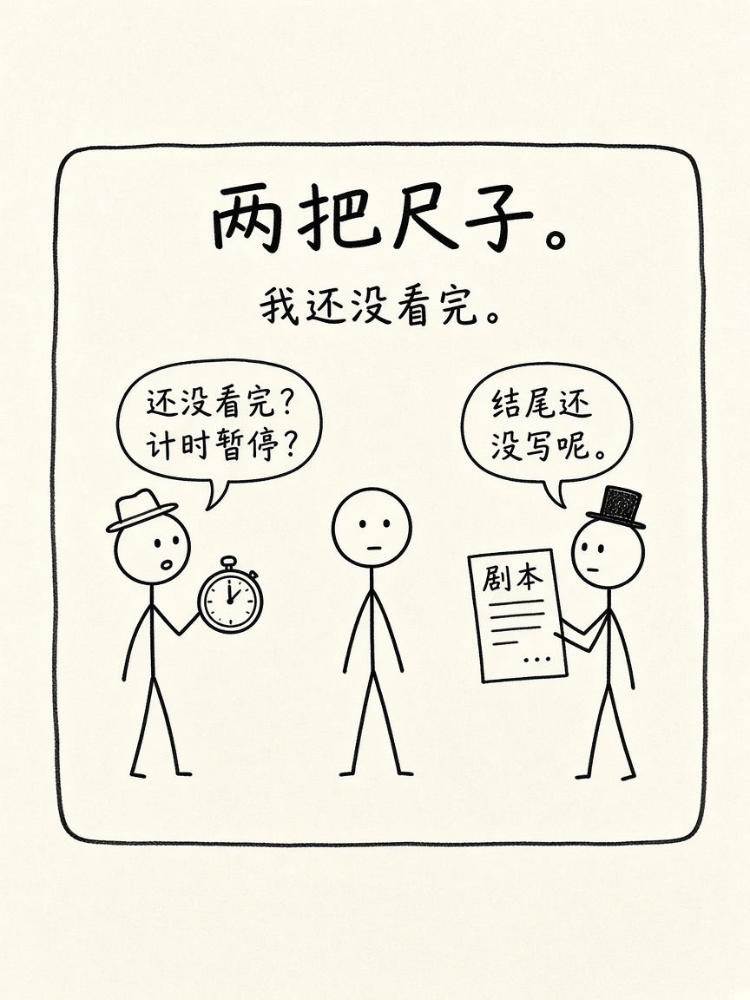

这两天刷 B 站，热搜挂着一句，一人打造 78 分钟硬科幻 AI 电影。我点进去，是野生锅导演的《孤鲸》，片长 1 小时 18 分 7 秒，播放两百四十多万。简介没写月份，也没写花了多少钱，只说这是刘慈欣《山》之后的第二部，拿去参加华语科幻星云奖和 RunningHub 的长片赛。我还没把这 78 分钟看完。坦率的讲，热搜在数一个人能不能把片子做长，比赛在看故事讲不讲得完。

怎么说呢，先松的是短片。北京晚报 10 月写过，百花奖把最佳短片给了一个人做的《莽古斯》。山音那部短片，拿的是戛纳科幻电影国际峰会的金奖，主竞赛没这回事。一人剧组，就是编剧、导演、后期都是同一个人。

9 月 8 号，RunningHub 跟第十七届华语科幻星云奖办了长片赛。星云奖你就当华语科幻的文学奖，2010 年办到现在。奖金池 550 万，单项最高 100 万现金，刘慈欣当顾问，11 月 13 号到 15 号线下颁奖。这赛看的是电影和长剧，故事得讲完。

野生锅上一张考卷是自己出的。刘慈欣的《山》，标题里写着一个人、业余、18 个月、2 万元、94 分钟，2025 年 2 月开始做。那条播放三百七十五万。你想想看，账是他自己报的。

到了《孤鲸》，热搜还在用《山》那把尺子。月份和钱，这条简介是空的。我寻思了一下，「一个人」这三个字，是热搜帮他写上去的。

标题说改编自星云奖最佳短篇，篇名没写。另一位 up 已经用谢云宁那篇《这颗星球上最孤独的那一只鲸鱼》做了先导《鲸歌》，我不能把那篇安到《孤鲸》头上。预告片里他只写了，版权是星云奖正版授权。

我还没看完，不敢替热搜打分，也不敢替评委打分。你要是也只看了标题，咱们一样。
