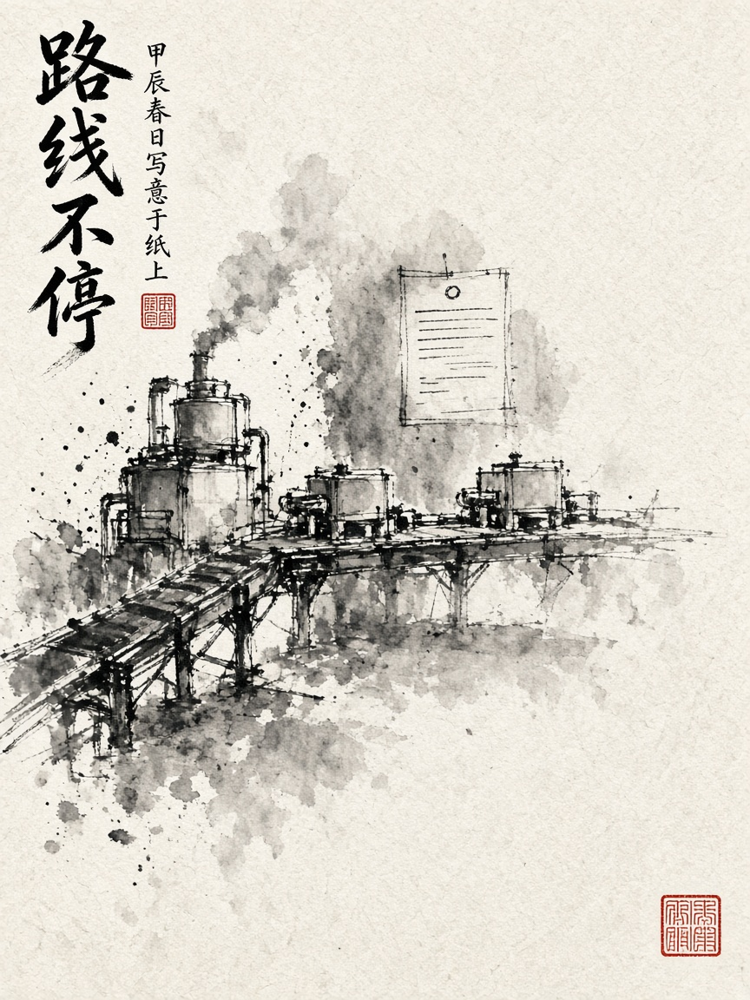

这两天刷到英伟达那份交接公告，黄仁勋辞去总裁、CEO、董事，即刻生效。临时 CEO 是干了十三年的 CFO 克雷斯，董事会还第一次设了主席。我还没去翻他们下一季电话会实录。坦率的讲，我觉得市场吵的是人，供应链怕的是下一轮产能还敢不敢提前锁。

11 月 12 日公告落地，掌舵三十三年的人离开管理层。怎么说呢，辞职两个字，比调查结论来得更快。

克雷斯接手临时 CEO，原来的 CFO 岗还兼着。琼斯当上首位董事会主席，正式人选内外都找。

公司说运营、客户承诺、产品路线不中断。你想想看，这话是给客户和员工听的定心丸。

亚洲供应商更怕另一件事，新老板还会不会像他那样提前锁制造产能、砸生态大单。

CUDA 和现有供货协议不会一夜蒸发。比较骚的是，护城河还在，签长单的那只手换了。

国内这边看算力的，也可以对一下时间表。五天后有财报电话会，门面稳不稳，那时更能听出来。
