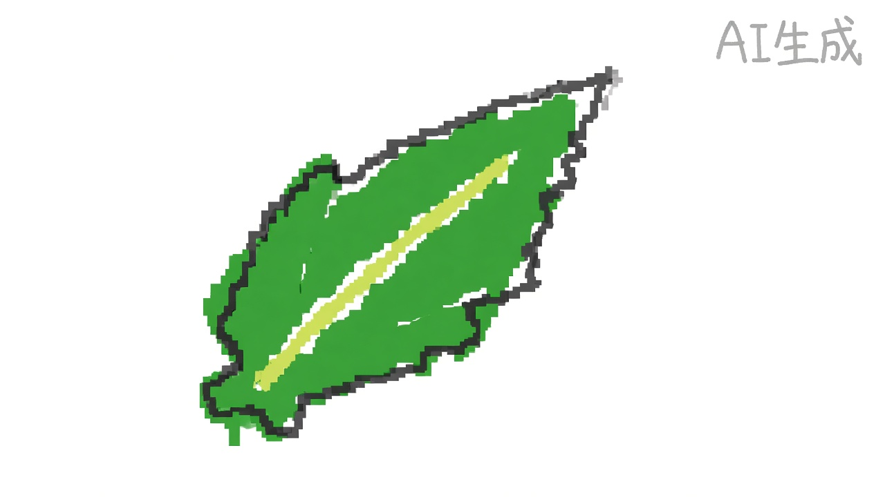
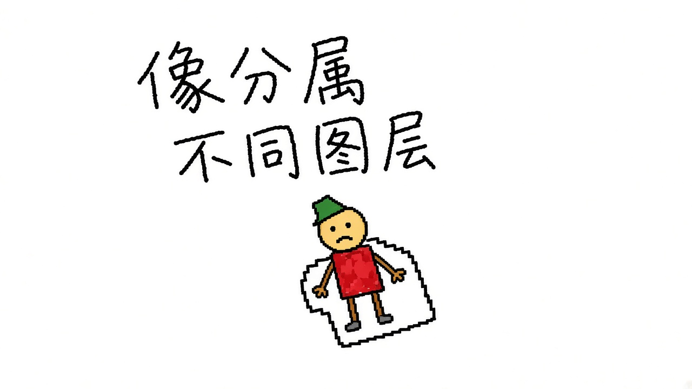
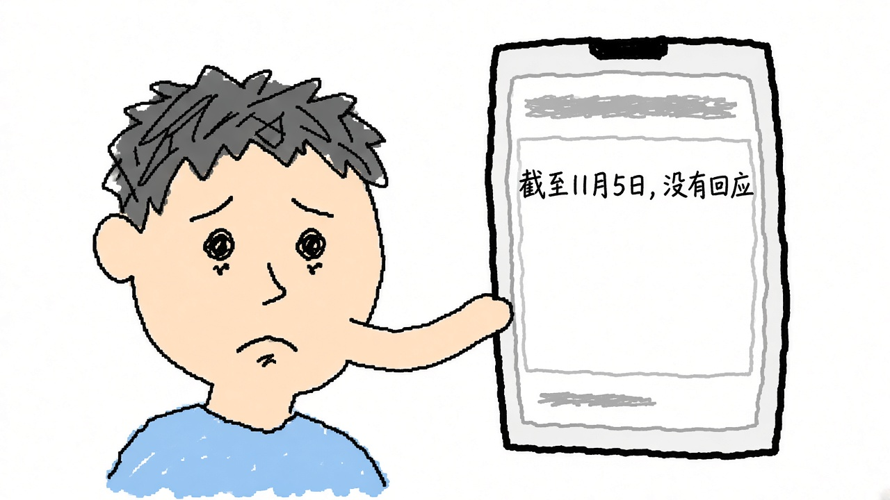
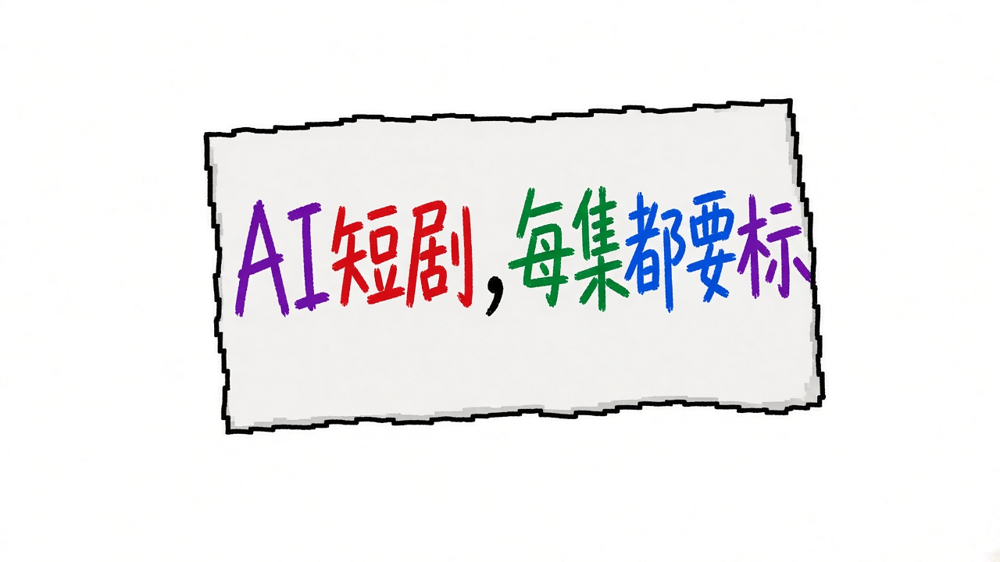
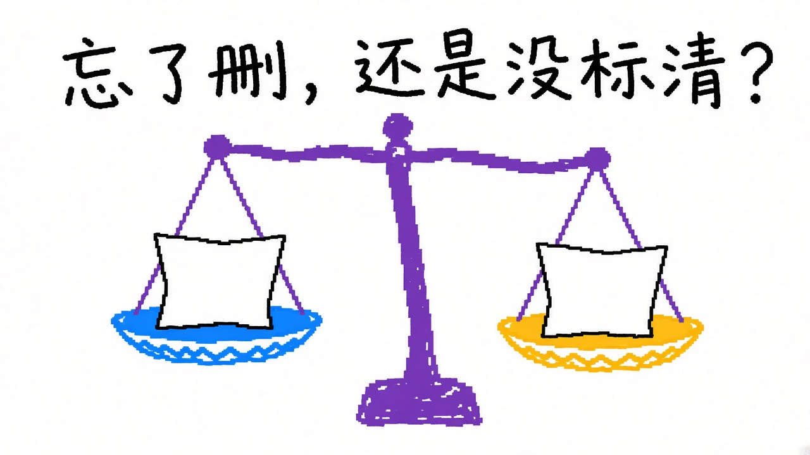
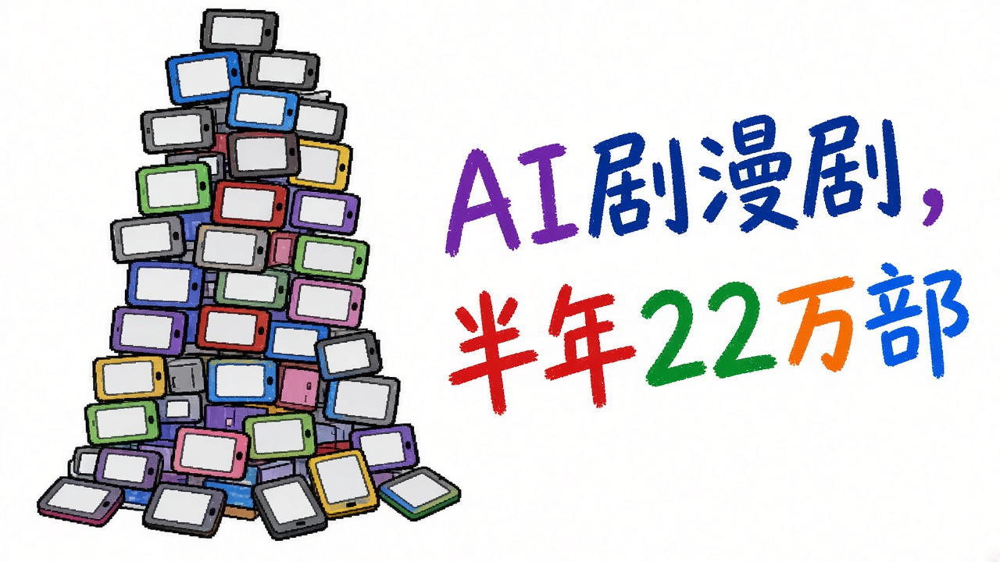
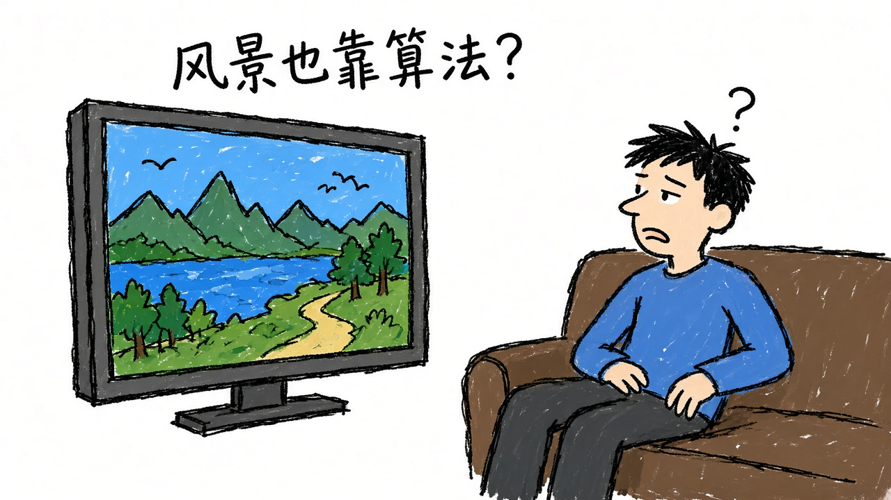

这两天刷到《嫁金钗》大结局后被观众抓到一个小尾巴，一段竹叶空镜的右上角，留着一个镜像反过来的「AI 生成」。我没追过这部剧，只看了报道和截图，剧方和优酷到现在也没回应。AI 做空镜我觉得不算新鲜事，让我在意的是另一头，AI 短剧已经被要求每集都得标出来了，长剧要是连风景都交给算法，观众凭什么不去刷免费的？

大结局播完，有观众在一段竹叶空镜的右上角，看到了四个浅色的字，镜像反着的「AI 生成」。不仔细看，还真发现不了。

还有网友说，一段只有俯拍的士兵戏份，人和背景融得不太好，像是两层图。这只是网友的看法，我没法替他们验证。

到 11 月 5 日，剧方和优酷都没有正式回应。后面这些我都只当报道来讲，你也别当判决看。

澎湃那篇评论说，用 AI 生成空镜在影视行业已经挺常见，不光这一部在用。怎么说呢，这点我倒不意外。

反过来看 AI 短剧，9 月 1 日起《微短剧发展管理办法》施行，AI 做的微短剧每集明显位置都要加提示标识。这条管的是微短剧，不是《嫁金钗》这种长剧。

一位律师的说法是，画面里清晰标出「可能含 AI 制作内容」，才算初步尽到提示义务，只剩一个模糊的镜像标识，有合规风险。澎湃那篇评论的判断更直接，就是忘了去水印。

澎湃另一篇报道里有组数，今年上半年抖音上原生 AI 剧漫剧新上线 22.19 万部，用户从 1.2 亿涨到 6 亿。你想想看，长剧夹在中间，压力确实不小。

按评论的说法，真人长剧能拿出来比的，是演员的表演、美术置景和实景。空镜远景要是都靠廉价的 AI 素材，等于自毁长城。这话听着有点刺耳，但我是同意的。
