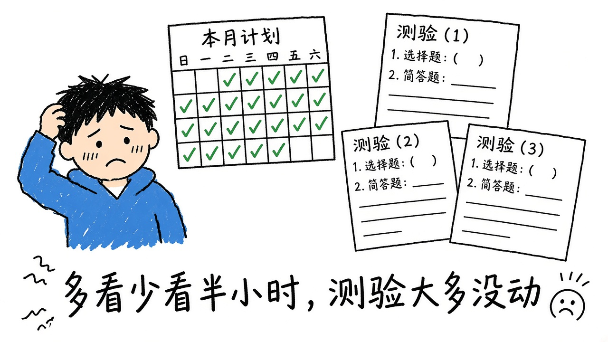
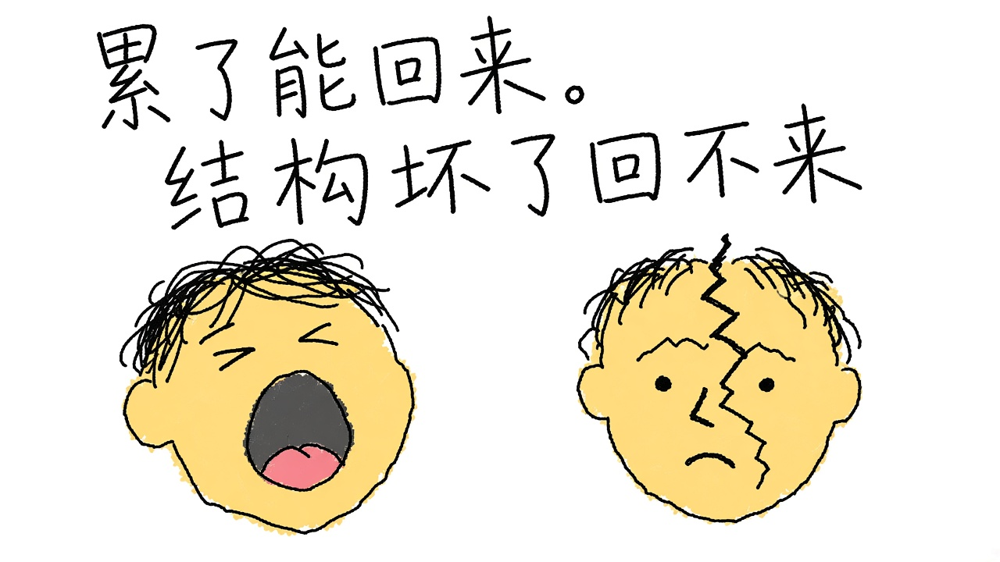
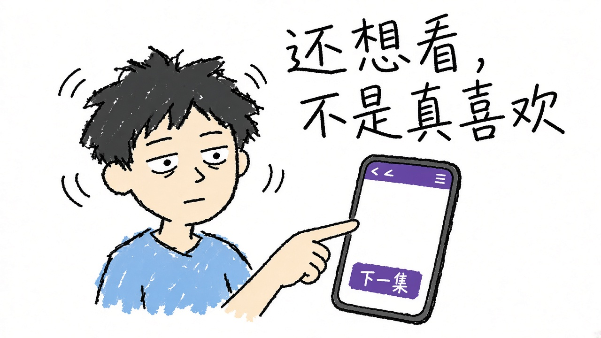
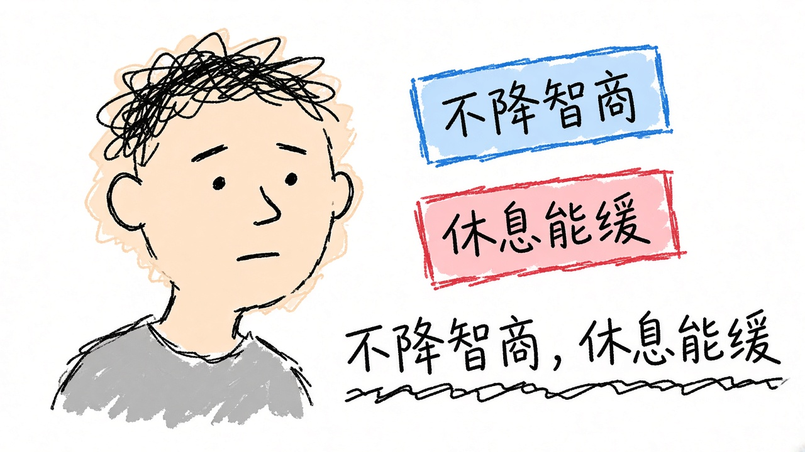
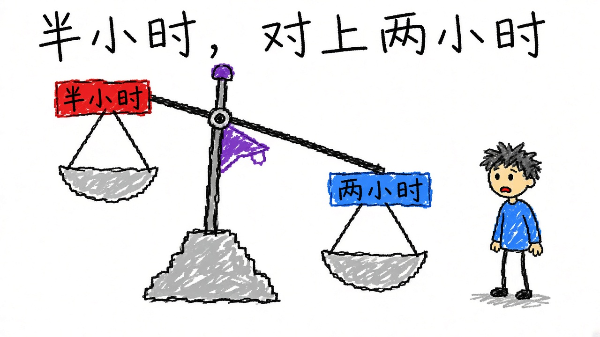
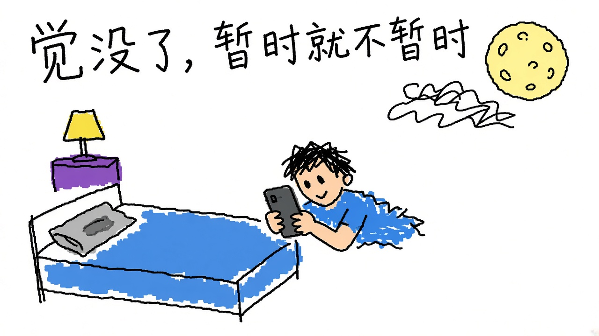

这两天热搜上挂着一句，刷短剧真的会让人变笨吗。我把今天中国之声那篇，和外面的研究对着看了一遍。医生说不会把智商刷没，你刷完发懵、书也看不进去，这感觉也是真的。我觉得大家容易只记住前半句。要缓过来，得把觉睡回来，下一集最擅长的，就是把睡觉和慢事一起拿走。

短视频用得越多，注意力越差，管住手也越难。怎么说呢，这是一起出现，不是你看一场就永久变笨。

台湾中正大学就41个人，盯了18天。你想想看，相关响得很，尺子一量又安静了，作者也说因果还没钉死。

变笨感多半是累，刚记住的东西和耐心会暂时掉一档。脑子结构坏了，医生叫器质性损伤，休息补不回来。我觉得热搜把这两件事叠成了一个词。

短剧隔一会儿就反转一次。剧可以很烂，钩子照样把人勾住。贵阳心身科的黄颖是这么讲的。

合肥胡冉冉、三明陈晓兰说的是这句。北京安定医院王雪初把日常放在大约每天30分钟。坦率的讲，半小时我不确定人人守得住。

2025年12月的报告写，用微短剧的人人均一天129分钟，已经超过长视频。说的是用这类应用的人，不是每个中国人。我觉得这四倍比变笨两个字好笑。

要缓过来，得靠睡觉把劲补回来。刷到后半夜，累就叠在缺觉上。说真的，看书干活这些慢事也跟着倒霉，回报来得晚。

永久变笨别当真。我也没把自己关进实验室验证过。觉还回去，慢事留一点，短剧当歇脚就行。
