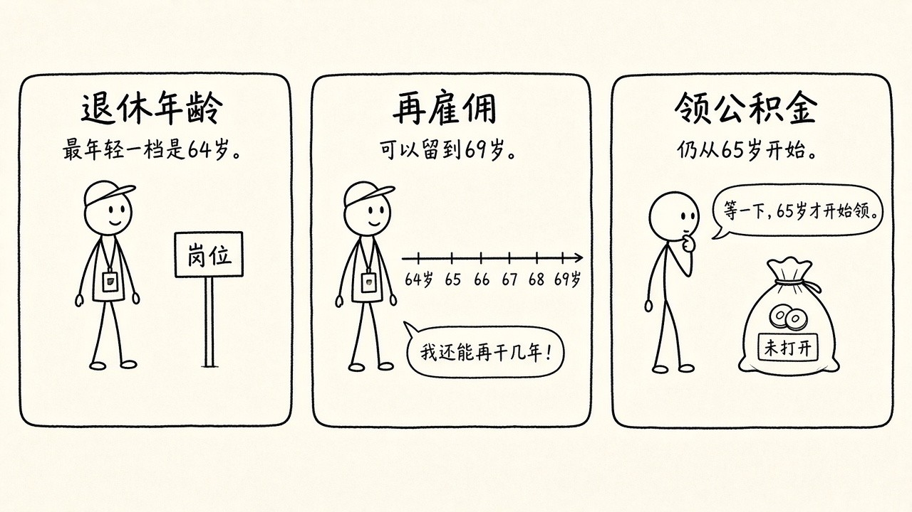
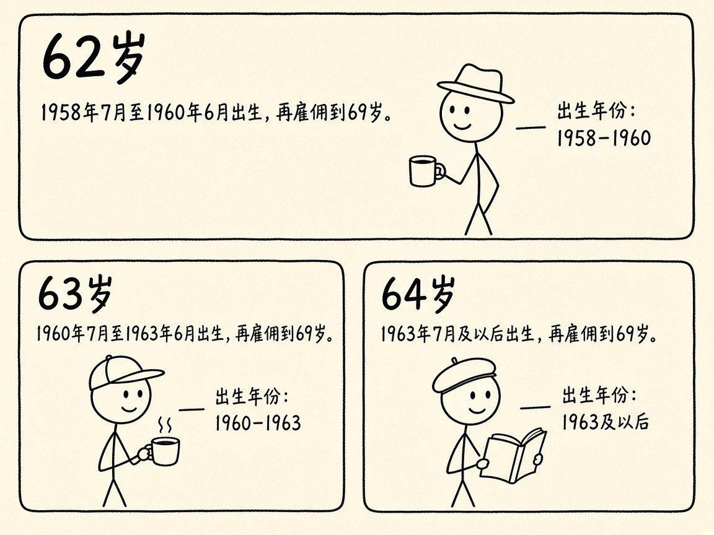
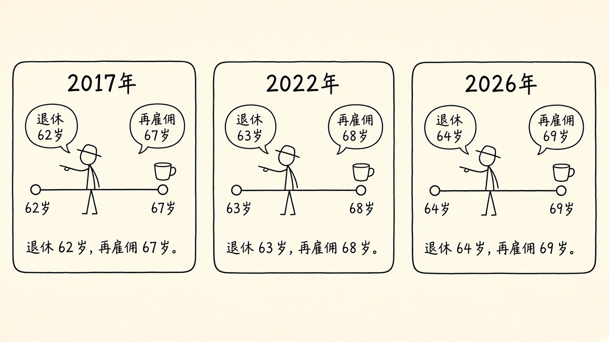
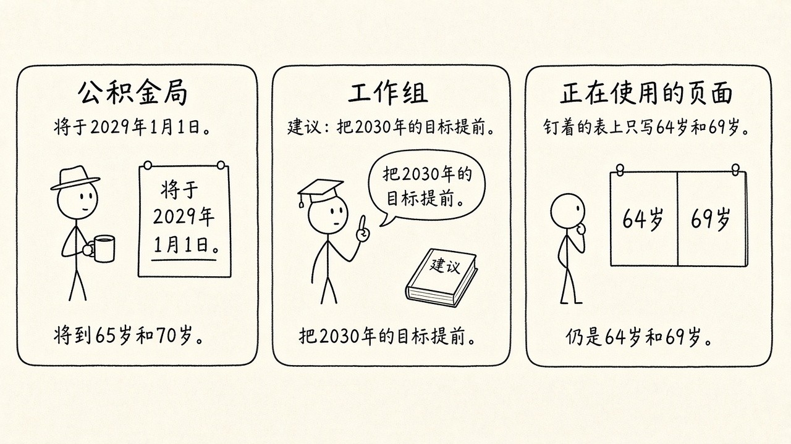
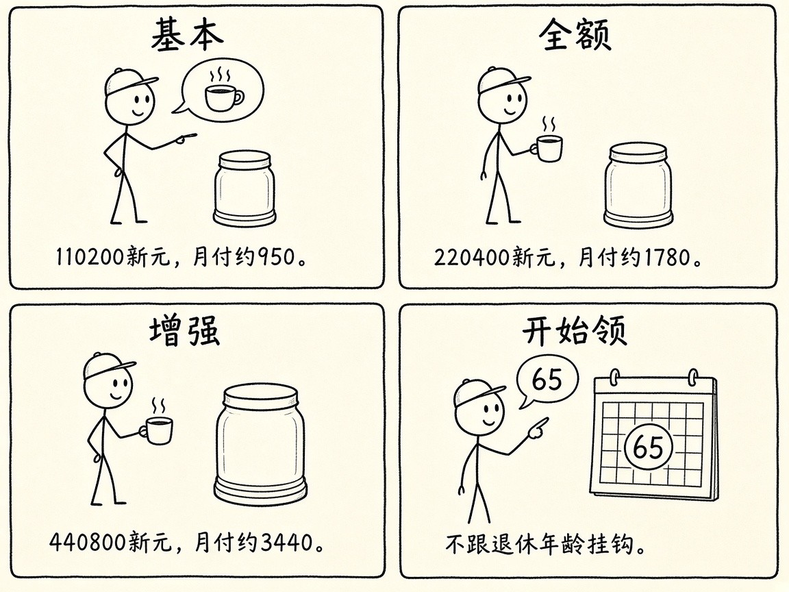
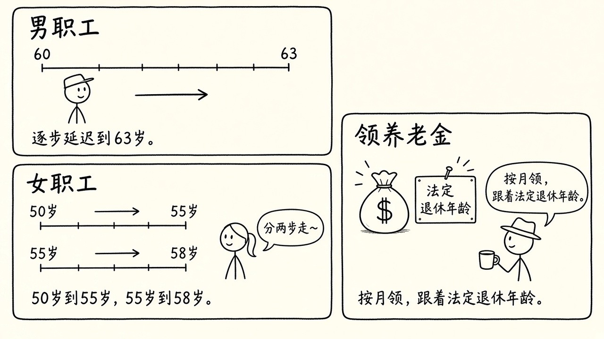

雇佣规则管雇主能不能因为年纪辞人。领取规则管钱从哪一年按月拿，写在公积金局另一页。

「64岁」只落在最年轻这一档。前两档的人，法定退休年龄仍是62岁或63岁。

这三档写在人力部2026年工作组附件里。64岁和69岁已经上了正在使用的页面。

公积金局这页的日期是2025年11月7日。要提前的2030年，来自2019年老龄劳动力工作组定下的目标。

这是2026年满55岁的人，按标准计划、4%利率、从65岁起领的估算。没存到全额或基本标准，65岁仍可以领，月付更低。

2025年1月1日起用15年调完：男职工和原55岁的女职工每4个月延1个月，原50岁的女职工每2个月延1个月。按月领基本养老金还要凑够最低缴费年限，2030年起由15年逐步提到20年。
