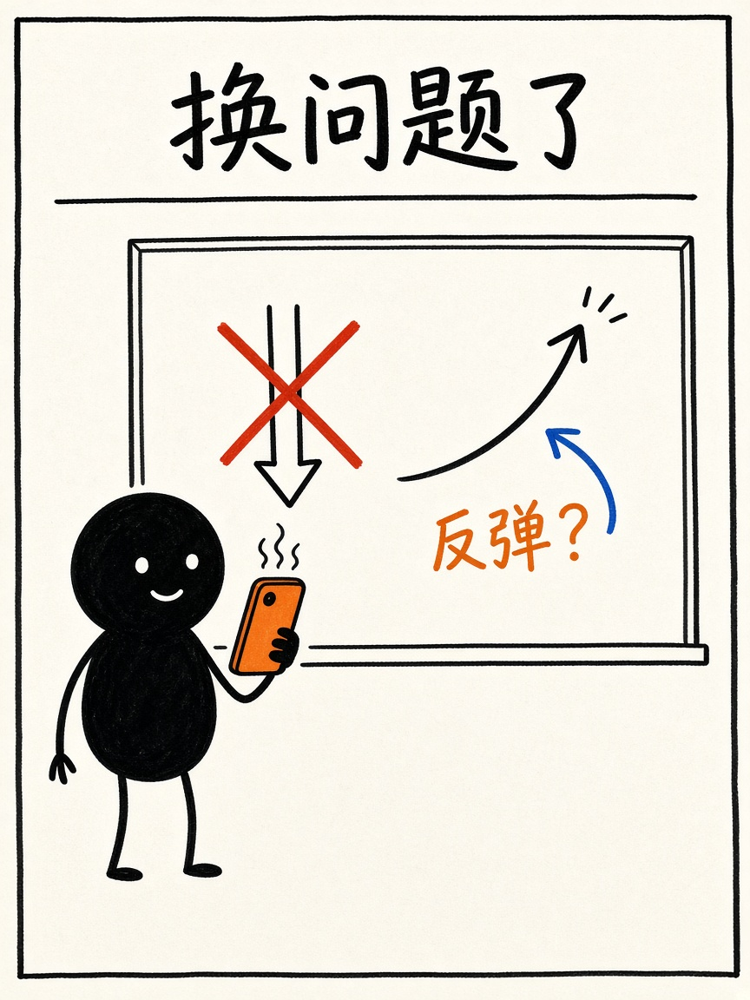
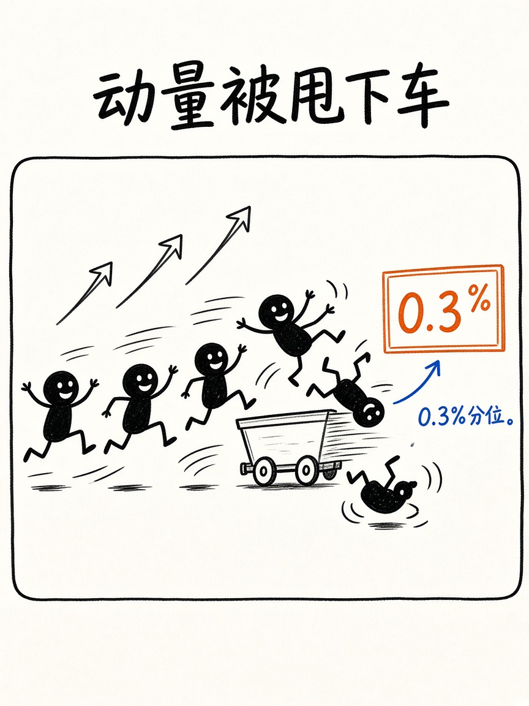
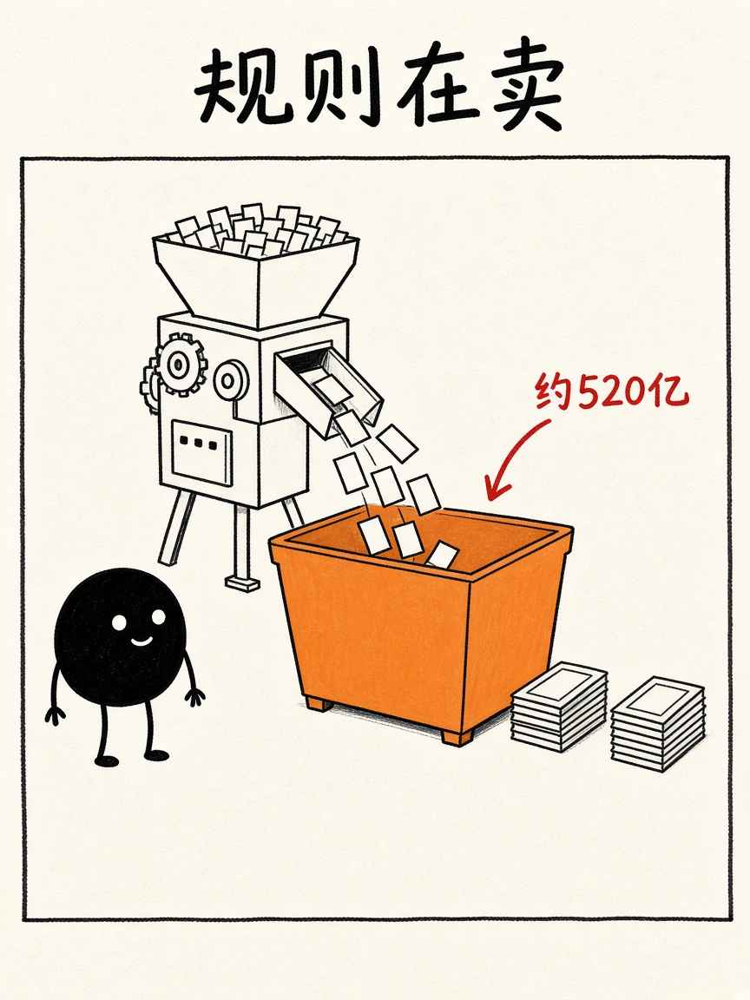
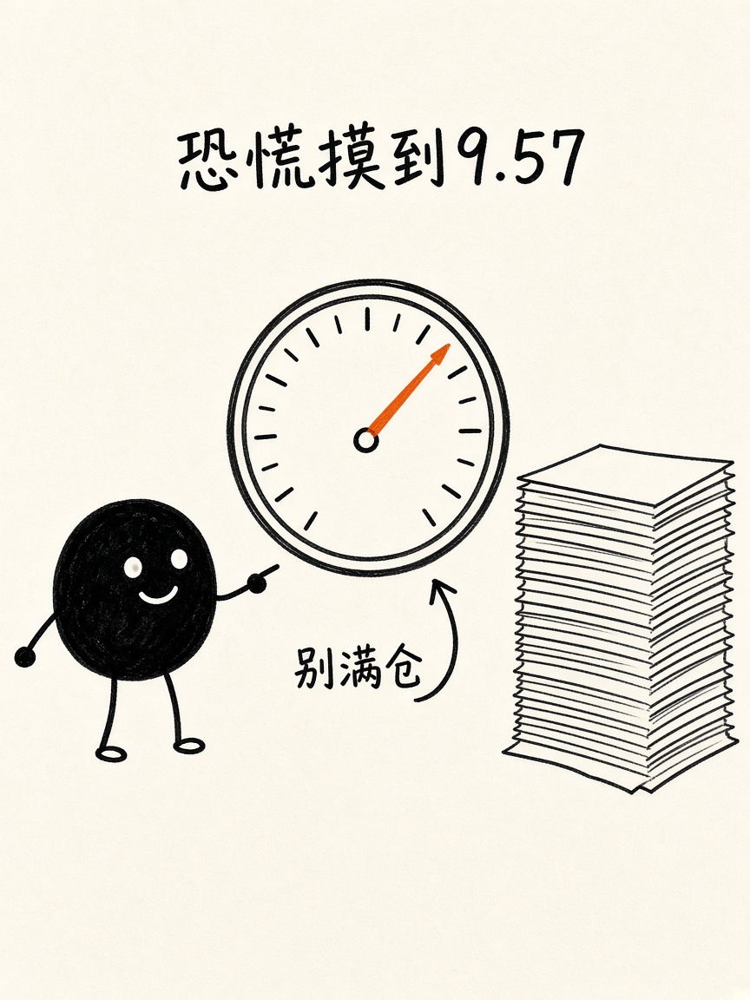
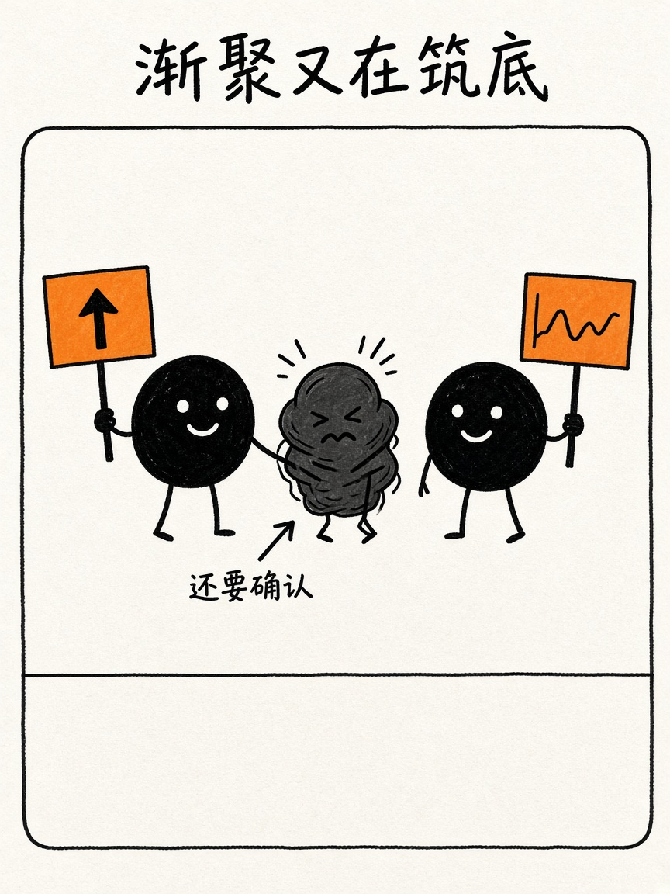
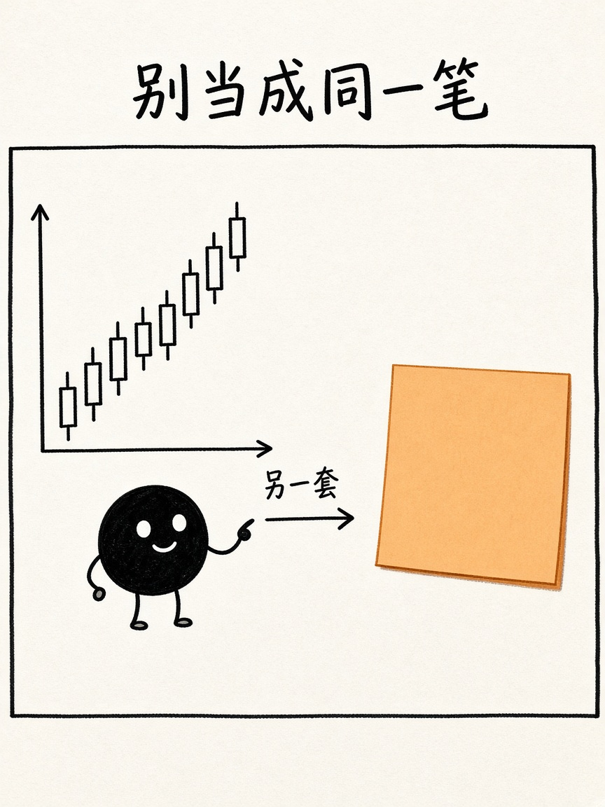

这两天刷到华尔街见闻和财联社转的一堆研判，话题已经不太像前几天那种「AI完了吗」，更像在问机械砸盘砸完没有，反弹近不近。坦率的讲，我觉得这是两件不同的事，卖压衰竭不等于全面反弹已经上桌。高盛那边写恐慌指标冲到9.57，历史上摸过这档之后三个月涨的概率大约八成，可同一拨人又说短期还在寻底，别急着把风险仓加满。我没亲自盯盘，也没核对那些原始台子日报，数字都是二手转述。读完想带走的是一张拆法，机械抛售快到尾声了，确认反弹还得再等一张条子。

怎么说呢，前几天还在吵信仰碎没碎，这两天电话又换成另一句，反弹是不是快到了。

动量这玩意，就是涨的时候继续追涨、跌的时候一起踩。过去一个月它相对大盘落后大约10.6个百分点，落在1989年以来最差的约0.3%分位，你想想看有多挤。

11月5日那天，摩根士丹利算过，杠杆ETF收盘前得机械卖出大约520亿美元。跌得越狠它越得卖，不是谁突然变空，是规则在干活。

高盛那套波动率恐慌指数摸到9.57，过了9.5那条线。历史上摸过这档之后，标普三个月里上涨概率大约八成，可他们自己也不让你听见这句话就满仓冲。

比较骚的事就在这。被动抛压开始消退，配置吸引力往上抬，同一份材料又写，单日反弹不等于出清结束，短期还得在高波动里找底。

我没在做交易，国内盘面走到哪，我也不敢装知道。美股这边在吵机械卖完没有，A股和港股听的是另一套资金和情绪。我觉得值得拿走的是这张拆法，不是跟涨跟跌那句口号。
